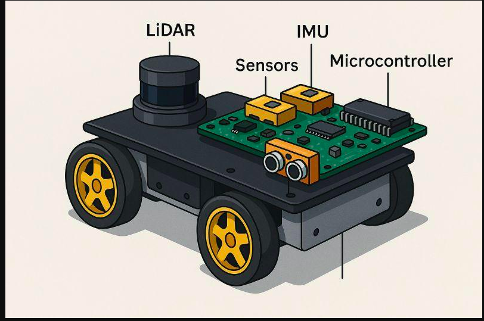
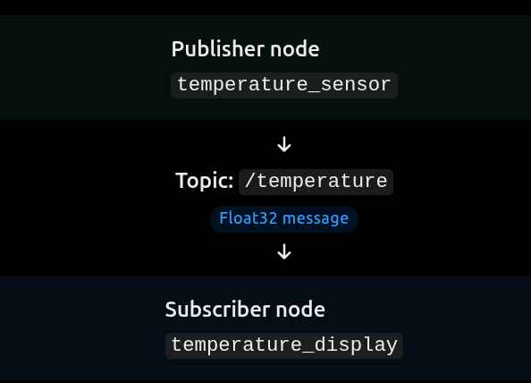

# ROS 2 fundamentals

Before building our robot, you need to understand how ROS 2 programs communicate.

We'll start with four important concepts:
1. Nodes
    
2. Topics
    
3. Publishers
    
4. Subscribers
    

## 1. What is a ROS 2 node?

A node is an individual program that performs a particular task in a robot system.

Imagine our future two-wheeled robot:

[How LiDAR and IMUs enable autonomous robots | Pooja Anandathirtha posted on the topic | LinkedIn](https://images.openai.com/static-rsc-4/C24SFgzFC05ADLiDkYOOkOLCiRKNA_I1KYdowyeVB8c10Wx-L03vKuTSRTABnwSEHtpCvz55-mU0KJ_y037l721AMhU4IYM6pJRM7Rt3GzNWSAAZSAKr2fndyQqSyn9Z4kfzKtLvh-nj32pPDoY2cF1ygI3Q2BK6rPZ-v5XRdmo?purpose=inline)



It might contain these nodes:

|Node|Responsibility|
|---|---|
|`sensor_node`|Reads sensor measurements|
|`motor_node`|Controls wheel motors|
|`lidar_node`|Processes laser scanner data|
|`camera_node`|Processes camera images|
|`teleop_node`|Receives keyboard commands|
|`robot_state_publisher`|Publishes robot coordinate transforms|

Each node can run independently, but they communicate with other nodes.

Practical example: A temperature sensor node publishes a temperature reading. Another node subscribes to that reading and displays it.

## 2. What is a ROS 2 topic?

A topic is a named communication channel through which nodes exchange messages.

For example:

```text
/sensor/temperature
/cmd_vel
/scan
/joint_states
/odom
```

Consider the following communication:


The publisher sends messages. The subscriber receives them.

A topic can have multiple publishers and multiple subscribers, subject to the message type and communication settings.

# Phase 2 – Lesson 1: Create your own ROS 2 nodes

Now we'll stop depending on preinstalled demo programs and write our own ROS 2 programs.

Our first practical project will be a small robot status communication system.

## 1. Understand the difference between nodes and topics

Let's imagine our two-wheeled robot.

- A sensor node reads temperature.
    
- A motor node controls the wheels.
    
- A teleoperation node receives keyboard commands.
    

Each program is a node.

The nodes exchange information using topics.

|Term|Meaning|Example|
|---|---|---|
|Node|An independent ROS program|`sensor_node`|
|Topic|Communication channel|`/robot_status`|
|Publisher|Sends messages|`status_publisher`|
|Subscriber|Receives messages|`status_listener`|
|Message|Data being transmitted|`String`|

## 2. Create a ROS 2 workspace

We'll create our first custom package on your Ubuntu laptop.

Open the laptop's terminal, not SSH.

```bash
mkdir -p ~/ros2_ws/src
cd ~/ros2_ws
```

Source ROS 2:

```bash
source /opt/ros/humble/setup.bash
```

Check:

```bash
echo $ROS_DISTRO
```

Expected:

```bash
humble
```

## 3. Create your first ROS 2 Python package

A package is a collection of ROS 2 programs, configuration files and resources.

Navigate to the source directory:

```bash
cd ~/ros2_ws/src
```

Create the package:

```bash
ros2 pkg create robot_basics \
  --build-type ament_python \
  --dependencies rclpy std_msgs
```

Let's understand the command:

- `robot_basics`: Our package name.
    
- `ament_python`: We are creating a Python package.
    
- `rclpy`: Python library for ROS 2.
    
- `std_msgs`: Standard message types such as String, Int32 and Float32.
    

Your package structure will look like:

```text
ros2_ws/
└── src/
    └── robot_basics/
        ├── package.xml
        ├── setup.py
        ├── setup.cfg
        └── robot_basics/
            └── __init__.py
```

## 4. Create a publisher node

A publisher sends information to a topic.

Our program will publish the message:

```text
Robot is ready!
Robot is moving!
Robot is turning!
```

Create the Python file:

```bash
cd ~/ros2_ws/src/robot_basics/robot_basics

nano talker.py
```

Paste this code:

```python
import rclpy
from rclpy.node import Node
from std_msgs.msg import String


class RobotPublisher(Node):

    def __init__(self):
        super().__init__('robot_publisher')

        self.publisher = self.create_publisher(
            String,
            'robot_status',
            10
        )

        self.count = 0

        self.timer = self.create_timer(
            1.0,
            self.publish_message
        )

    def publish_message(self):

        msg = String()

        if self.count < 3:
            msg.data = "Robot is ready!"
        elif self.count < 6:
            msg.data = "Robot is moving!"
        else:
            msg.data = "Robot is turning!"

        self.publisher.publish(msg)

        self.get_logger().info(
            'Publishing: "%s"' % msg.data
        )

        self.count += 1


def main(args=None):

    rclpy.init(args=args)

    node = RobotPublisher()

    rclpy.spin(node)

    node.destroy_node()

    rclpy.shutdown()


if __name__ == '__main__':
    main()

```

### 5. Understand the publisher code

Let's understand the important statements.

A. Import ROS 2 libraries

```python
import rclpyfrom rclpy.node import Nodefrom std_msgs.msg import String
```

- `rclpy`: Allows Python programs to communicate with ROS 2.
    
- `Node`: Base class for creating ROS 2 nodes.
    
- `String`: Message type used to transmit text.
    

B. Create a node

```python
class RobotPublisher(Node):    def __init__(self):        super().__init__('robot_publisher')
```

This creates a ROS 2 node named:

```python
robot_publisher
```

C. Create a publisher

```python
self.publisher = self.create_publisher(    String,    'robot_status',    10)
```

There are three arguments:

|Argument|Meaning|
|---|---|
|`String`|Message type|
|`robot_status`|Topic name|
|`10`|Queue depth (QoS history depth)|

The full topic name will be:

```text
/robot_status
```

D. Create a timer

```python
self.timer = self.create_timer(    1.0,    self.publish_message)
```

This executes `publish_message()` every second.

E. Publish the message

```python
self.publisher.publish(msg)
```

This sends the message to the topic.

F. Keep the node running

```python
rclpy.spin(node)
```

This keeps the node alive and processes its callbacks.

Without this, the program would finish instead of continuously publishing messages.

## 6. Register the publisher in setup.py

ROS 2 needs to know how to execute our Python program using the `ros2 run` command.

Go to the package directory:

```bash
cd ~/ros2_ws/src/robot_basics
nano setup.py
```

Find the `entry_points` section and replace it with:

```python
entry_points={    'console_scripts': [        'talker = robot_basics.talker:main',    ],},
```

Save using `Ctrl+O`, Enter, then `Ctrl+X`.

What does this mean?

```python
talker = robot_basics.talker:main
```

- `talker`: Command we'll execute.
    
- `robot_basics.talker`: Python file/module.
    
- `main`: Function that starts the node.
    

## 7. Build the package

Go to your workspace:

```bash
cd ~/ros2_ws
```

Build:

```bash
colcon build
```

Source the workspace:

```bash
source install/setup.bash
```

Run your publisher:

```bash
ros2 run robot_basics talker
```

Expected output:

```text
[INFO] [robot_publisher]: Publishing: "Robot is ready!"
[INFO] [robot_publisher]: Publishing: "Robot is ready!"
[INFO] [robot_publisher]: Publishing: "Robot is ready!"
[INFO] [robot_publisher]: Publishing: "Robot is moving!"
```

Your first custom ROS 2 node!

## 8. Create a subscriber node

Now we'll write another program that receives the published messages.

Open a second terminal on your laptop.

Source ROS 2 and your workspace:

```bash
source /opt/ros/humble/setup.bash

source ~/ros2_ws/install/setup.bash
```

Create the file:

```bash
cd ~/ros2_ws/src/robot_basics/robot_basics

nano listener.py
```

Paste:

```python
import rclpy
from rclpy.node import Node
from std_msgs.msg import String


class RobotListener(Node):

    def __init__(self):
        super().__init__('robot_listener')

        self.subscription = self.create_subscription(
            String,
            'robot_status',
            self.receive_message,
            10
        )

    def receive_message(self, msg):

        self.get_logger().info(
            'Received: "%s"' % msg.data
        )


def main(args=None):

    rclpy.init(args=args)

    node = RobotListener()

    rclpy.spin(node)

    node.destroy_node()

    rclpy.shutdown()


if __name__ == '__main__':
    main()

```

### Understand the subscriber

The important part is:

```python
self.subscription = self.create_subscription(    String,    'robot_status',    self.receive_message,    10)
```

It has four arguments:

|Argument|Meaning|
|---|---|
|`String`|Expected message type|
|`robot_status`|Topic to subscribe to|
|`self.receive_message`|Callback function|
|`10`|Queue depth|

Whenever a message arrives, ROS 2 automatically calls:

```python
def receive_message(self, msg):
```

The received text is available in:

```python
msg.data
```

## 9. Register the subscriber

Open `setup.py` again:

```bash
cd ~/ros2_ws/src/robot_basics

nano setup.py
```

Your complete `entry_points` section should now contain both programs:

```python
entry_points={    'console_scripts': [        'talker = robot_basics.talker:main',        'listener = robot_basics.listener:main',    ],},
```

Rebuild:

```python
cd ~/ros2_ws

colcon build --packages-select robot_basics
```

Source:

```bash
source install/setup.bash
```

## 10. Run your publisher and subscriber

Terminal 1 – Publisher

```bash
ros2 run robot_basics talker
```

Terminal 2 – Subscriber

```bash
ros2 run robot_basics listener
```

Expected subscriber output

```text
Received: "Robot is ready!"
Received: "Robot is ready!"
Received: "Robot is moving!"
Received: "Robot is turning!"
```

Both nodes are communicating through `/robot_status`.

## 11. Inspect your ROS 2 system

ROS 2 provides terminal commands to inspect running nodes and topics.

Keep both programs running and open a third terminal.

### A. List running nodes

```bash
ros2 node list
```

Expected:

```text
/robot_listener
/robot_publisher
```

### B. List available topics

```bash
ros2 topic list
```

Expected:

```text
/robot_status
```

### C. Inspect the topic
```bash
ros2 topic info /robot_status
```

Expected:

```text
Type: std_msgs/msg/String
Publisher count: 1
Subscription count: 1
```

### D. Read topic messages directly

```bash
ros2 topic echo /robot_status
```

This displays messages without needing our subscriber program.

### E. Check publishing frequency

```bash
ros2 topic hz /robot_status
```

Expected:

```text
average rate: 1.000
```

### F. Understand the message structure

```bash
ros2 interface show std_msgs/msg/String
```

Expected:

```text
string data
```

This tells you that a String message contains a field named `data`.

## 12. Communicate with your Raspberry Pi

Let's use the custom publisher you just created.

Keep the publisher running on your laptop.

On your Raspberry Pi SSH terminal, execute:

```bash
source /opt/ros/humble/setup.bash

export ROS_DOMAIN_ID=23
export ROS_LOCALHOST_ONLY=0

ros2 topic echo /robot_status
```

Your Raspberry Pi should receive:

```text
data: Robot is ready!
---
data: Robot is moving!
---
data: Robot is turning!
---
```


## 1. `ros2 topic list`

This command displays all currently active topics.

Run it on your Ubuntu laptop or Raspberry Pi while the talker and listener are running:

```bash
ros2 topic list
```

Expected output may include:

```text
/parameter_events
/robot_status
/rosout
```

- `/robot_status` – our custom communication topic.
    
- `/rosout` – ROS 2 logging topic.
    
- `/parameter_events` – reports parameter changes.
    

## 2. `ros2 topic echo`

This command displays messages being published to a topic.

```bash
ros2 topic echo /robot_status
```

Expected output:

```text
data: Robot is ready!
---
data: Robot is ready!
---
data: Robot is moving!
---
```

The `---` separates individual messages.

You can run this command on your Raspberry Pi to observe messages sent by the laptop.

## 3. `ros2 topic info`

This command displays information about a particular topic.

```bash
ros2 topic info /robot_status
```

Expected output:

```text
Type: std_msgs/msg/String
Publisher count: 1
Subscription count: 1
```

This tells us:

- One node is publishing messages.
    
- One node is subscribing.
    
- Both use the `String` message type.
    

## 4. `ros2 topic hz`

This command measures how frequently messages are published.

```bash
ros2 topic hz /robot_status
```

Expected output:

```text
average rate: 1.000
```

Your publisher uses a timer of `1.0` seconds, so it publishes approximately once per second.

## 5. Practical exercise: Publish a message manually

You can publish messages without running your Python talker program.

First, stop the existing talker by pressing `Ctrl + C` in its terminal.

On your laptop, run:

```bash
ros2 topic pub /robot_status std_msgs/msg/String "{data: 'Manual test message'}"
```

This publishes a message to `/robot_status`.

On your Raspberry Pi, the listener should display:

```text
Received: "Manual test message"
Received: "Manual test message"
```

By default, `ros2 topic pub` continuously publishes messages.

To publish just once, use:

```bash
ros2 topic pub --once /robot_status std_msgs/msg/String "{data: 'Hello Robot'}"
```

---

[Next: Services](./services.md)
