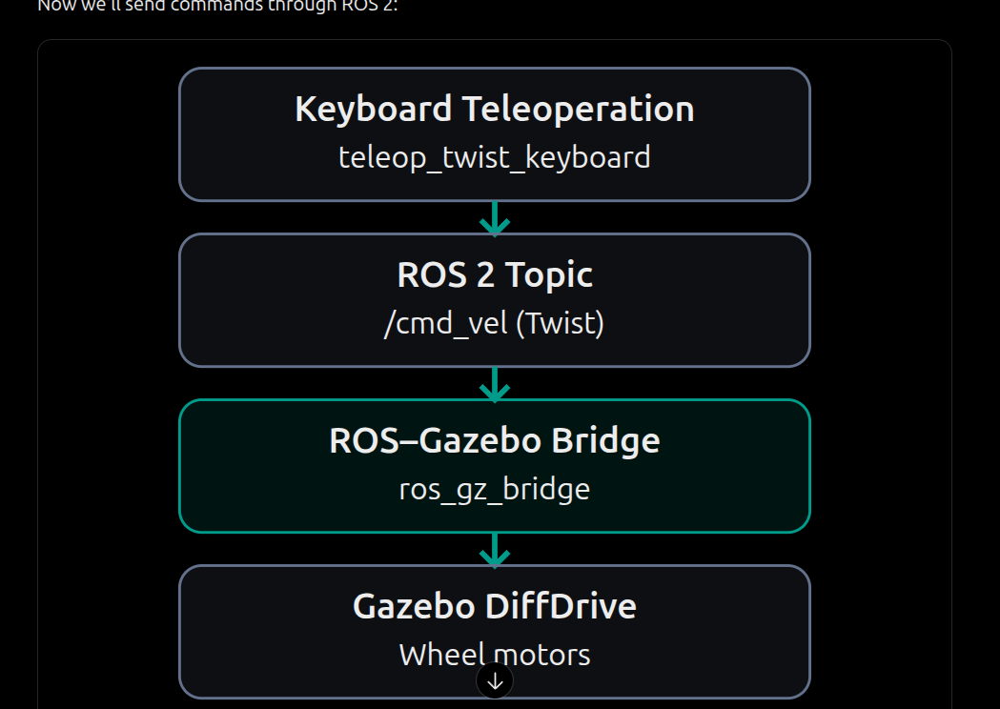

Differential drive working

Your robot now moves in Gazebo using `ign topic`. Next, we'll control it using **ROS 2 topics and keyboard teleoperation**.

## **1. Understand the architecture**

Previously, we sent commands directly to Gazebo:

```bash
ign topic → Gazebo DiffDrive → Robot
```

Now we'll send commands through ROS 2:

The bridge converts ROS 2 messages into Gazebo Transport messages.

## **2. Install keyboard teleoperation**

On your Ubuntu laptop:

```bash
sudo apt update
sudo apt install ros-humble-teleop-twist-keyboard
```


## **3. Start the simulation**

**Terminal 1 — Gazebo**

```bash
ign gazebo empty.sdf
```

Spawn your updated robot from another terminal:

```bash
ros2 run ros_gz_sim create \
  -world empty \
  -file /ros2_ws/src/robot_description/urdf/my_robot_generated.urdf \
  -name my_robot \
  -z 0.5
```

## **4. Start the ROS–Gazebo bridge**

**Terminal 2 — Bridge**

```bash
source /opt/ros/humble/setup.bash

ros2 run ros_gz_bridge parameter_bridge \
  '/cmd_vel@geometry_msgs/msg/Twist]ignition.msgs.Twist'
```

Here:

- `/cmd_vel` is the topic name.
    
- `geometry_msgs/msg/Twist` is the ROS 2 message type.
    
- `ignition.msgs.Twist` is the Gazebo message type.
    
- `]` means communication from ROS 2 to Gazebo.
    

The bridge must remain running.

## **5. Start keyboard control**

**Terminal 3 — Teleoperation**

```bash
source /opt/ros/humble/setup.bash

ros2 run teleop_twist_keyboard teleop_twist_keyboard
```

In Humble, `teleop_twist_keyboard` publishes plain `geometry_msgs/msg/Twist` on `/cmd_vel`, which is exactly what the bridge expects, so no extra parameters are needed.

You'll see keyboard controls similar to:

```text
Moving around:
   u    i    o
   j    k    l
   m    ,    .

q/z : increase/decrease max speeds
w/x : increase/decrease linear speed
e/c : increase/decrease angular speed
```

Use these keys:

|Key|Action|
|---|---|
|`i`|Move forward|
|`,`|Move backward|
|`j`|Rotate left|
|`l`|Rotate right|
|`k`|Stop|
|`u`|Forward and turn left|
|`o`|Forward and turn right|

Keep the teleoperation terminal focused while pressing keys.

## **6. Verify ROS 2 communication**

Open a fourth terminal:

```bash
ros2 topic list
```

You should find:

```text
/cmd_vel
```

Inspect its message type:

```bash
ros2 topic info /cmd_vel
```

Expected type:

```text
geometry_msgs/msg/Twist
```

To inspect messages:

```bash
ros2 topic echo /cmd_vel
```

Press `i`, `j` or `l` in the teleoperation terminal and watch the values change.

---

[Next: Odometry, TF2, and RViz2 integration](./odometry-integration.md)
