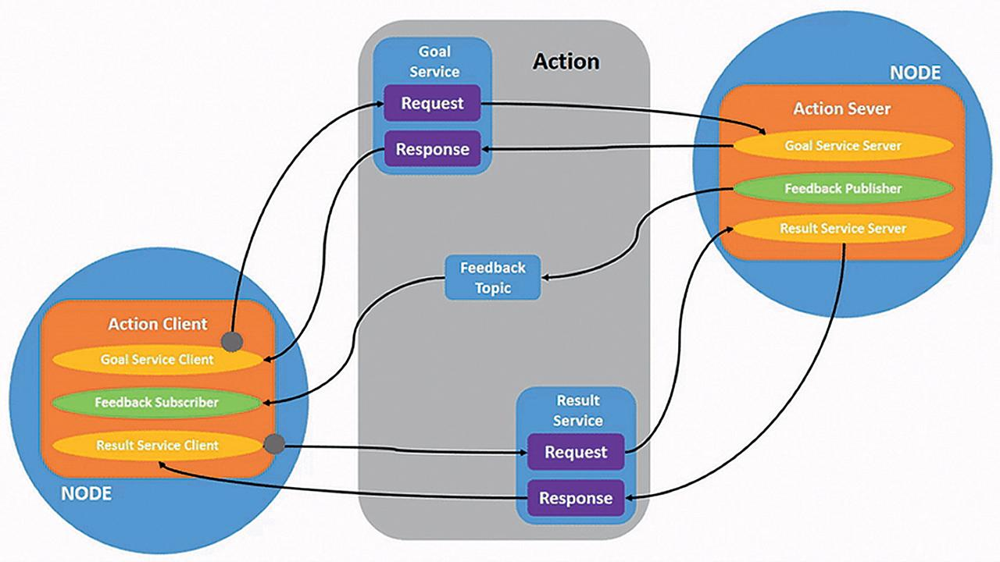

# Actions

You've learned two important ROS 2 communication methods:

1. Topics: Continuous message exchange.
    
2. Services: Request and response.
    

Now we'll learn the third method: Actions.

Actions are used when a robot needs to perform a task that takes some time to complete.

Examples:

- Move a robot 2 metres forward.
    
- Rotate a robot by 90 degrees.
    
- Navigate to a destination.
    
- Pick up an object using a robotic arm.
    

## 1. What is a ROS 2 Action?

Imagine asking your robot to move forward by 2 metres.

The communication works like this:

[Programiranje robota pomoću ROS 2 sustava - VidiLAB](https://images.openai.com/static-rsc-4/rXc0HyTlP1R2c01f2jbfDz1x6xkBwJBO7xEnLkdMTgHNSwo3akKBAg-k2l23VAT0PTT3THTxSqOf8CFskBlCPapUx3V2eUrfR3ki86mqPkVEO9sApIHp95J9pjMH6mFmxB2GCvDmGU4APbA39tJvNWxeIf41dZxYW_i_wYEN8cw?purpose=inline)

[vidilab.com](https://www.vidilab.com/teme/softverska-tema/7895-programiranje-robota-pomocu-ros-2-sustava)

1. Goal: Client requests the robot to move 2 metres.
    
2. Feedback: Robot continuously reports its progress.
    
3. Result: Robot reports when the movement is completed.
    

### Topics vs Services vs Actions

|Feature|Topics|Services|Actions|
|---|---|---|---|
|Communication|Continuous|Request-response|Goal-feedback-result|
|Duration|Continuous|Usually short|Usually long|
|Feedback|No built-in goal feedback|No|Yes|
|Cancellation|No built-in cancellation|No|Yes|
|Example|Sensor readings|Motor ON/OFF|Move robot to destination|

## 2. Our first action example

We'll use a built-in ROS 2 action called `Fibonacci`.

It calculates a Fibonacci sequence and sends feedback while calculating.

For example:

```text
0, 1, 1, 2, 3, 5, 8
```

This is useful for understanding how actions work before implementing robot movement.

## 3. Create the action package

We'll work on your Ubuntu laptop.

```python
cd ~/ros2_ws/src

ros2 pkg create robot_actions \
--build-type ament_python \
--dependencies rclpy example_interfaces
```

If ROS 2 cannot find `example_interfaces`, install it:

```bash
sudo apt install ros-humble-example-interfaces
```

## 4. Create the action server

Create the file:

```bash
cd ~/ros2_ws/src/robot_actions/robot_actions

nano fibonacci_server.py
```

Paste this code:

```python
import time
import rclpy

from rclpy.node import Node
from rclpy.action import ActionServer
from example_interfaces.action import Fibonacci


class FibonacciServer(Node):

    def __init__(self):
        super().__init__('fibonacci_server')

        self.action_server = ActionServer(
            self,
            Fibonacci,
            'fibonacci',
            self.execute_callback
        )

        self.get_logger().info('Fibonacci action server ready!')

    def execute_callback(self, goal_handle):

        self.get_logger().info('Goal received!')

        feedback = Fibonacci.Feedback()
        feedback.sequence = [0, 1]

        for i in range(1, goal_handle.request.order):

            feedback.sequence.append(
                feedback.sequence[i] + feedback.sequence[i - 1]
            )

            goal_handle.publish_feedback(feedback)

            self.get_logger().info(
                'Current sequence: %s' % feedback.sequence
            )

            time.sleep(1)

        goal_handle.succeed()

        result = Fibonacci.Result()
        result.sequence = feedback.sequence

        return result


def main(args=None):

    rclpy.init(args=args)

    node = FibonacciServer()

    rclpy.spin(node)

    node.destroy_node()

    rclpy.shutdown()


if __name__ == '__main__':
    main()
```

### Understand the important parts

1. Create the action server

```python
self.action_server = ActionServer(    self,    Fibonacci,    'fibonacci',    self.execute_callback)
```

This creates an action server named `/fibonacci`.

2. Receive the goal

```python
goal_handle.request.order
```

The client tells the server how many Fibonacci calculations to perform.

3. Send feedback

```python
goal_handle.publish_feedback(feedback)
```

This sends progress updates to the client while the calculation is running.

4. Complete the goal

```python
goal_handle.succeed()
```

This tells ROS 2 that the action has completed successfully.

5. Return the result

```python
return result
```

This sends the final Fibonacci sequence to the client.

## 5. Register the server executable

Open:

```bash
cd ~/ros2_ws/src/robot_actions
nano setup.py
```

Set the `entry_points` section to:

```text
entry_points={    'console_scripts': [        'fibonacci_server = robot_actions.fibonacci_server:main',    ],},
```

## 6. Build the package

```bash
cd ~/ros2_ws

colcon build --packages-select robot_actions

source install/setup.bash
```

## 7. Run the action server

In Terminal 1:

```bash
ros2 run robot_actions fibonacci_server
```

Expected output:

```text
Fibonacci action server ready!
```

Keep it running.

## 8. Create the action client

Open another terminal and create:

```bash
cd ~/ros2_ws/src/robot_actions/robot_actions

nano fibonacci_client.py
```

Paste this code:

```python
import rclpy

from rclpy.node import Node
from rclpy.action import ActionClient
from example_interfaces.action import Fibonacci


class FibonacciClient(Node):

    def __init__(self):
        super().__init__('fibonacci_client')

        self.client = ActionClient(
            self,
            Fibonacci,
            'fibonacci'
        )

    def send_goal(self):

        self.client.wait_for_server()

        goal = Fibonacci.Goal()
        goal.order = 7

        self.get_logger().info('Sending goal...')

        future = self.client.send_goal_async(
            goal,
            feedback_callback=self.feedback_callback
        )

        rclpy.spin_until_future_complete(self, future)

        goal_handle = future.result()

        if not goal_handle.accepted:
            self.get_logger().info('Goal rejected!')
            return

        self.get_logger().info('Goal accepted!')

        result_future = goal_handle.get_result_async()

        rclpy.spin_until_future_complete(self, result_future)

        result = result_future.result().result

        self.get_logger().info(
            'Final result: %s' % result.sequence
        )

    def feedback_callback(self, feedback_msg):

        feedback = feedback_msg.feedback

        self.get_logger().info(
            'Feedback: %s' % feedback.sequence
        )


def main(args=None):

    rclpy.init(args=args)

    node = FibonacciClient()

    node.send_goal()

    node.destroy_node()

    rclpy.shutdown()


if __name__ == '__main__':
    main()
```

### Understand the client

1. Create an action client

```python
self.client = ActionClient(    self,    Fibonacci,    'fibonacci')
```

Connects to the `/fibonacci` action server.

2. Set the goal

```python
goal = Fibonacci.Goal()goal.order = 7
```

Requests a Fibonacci sequence with order 7.

3. Send the goal

```python
future = self.client.send_goal_async(    goal,    feedback_callback=self.feedback_callback)
```

Sends the goal and registers a callback to receive feedback.

4. Receive feedback

```python
def feedback_callback(self, feedback_msg):
```

This function runs whenever the server publishes feedback.

5. Get the final result

```python
result_future = goal_handle.get_result_async()
```

Requests the final result after the action completes.

## 9. Register the client executable

Open:

```bash
cd ~/ros2_ws/src/robot_actions
nano setup.py
```

Update `entry_points`:

```text
entry_points={    'console_scripts': [        'fibonacci_server = robot_actions.fibonacci_server:main',        'fibonacci_client = robot_actions.fibonacci_client:main',    ],},
```

## 10. Build and run

Build again:

```bash
cd ~/ros2_ws

colcon build --packages-select robot_actions

source install/setup.bash
```

Terminal 1

Start server

```bash
source ~/ros2_ws/install/setup.bash
ros2 run robot_actions fibonacci_server
```

Terminal 2

Start client

```bash
source ~/ros2_ws/install/setup.bash
ros2 run robot_actions fibonacci_client
```

Expected client output will look similar to:

```text
Sending goal...
Goal accepted!
Feedback: [0, 1, 1]
Feedback: [0, 1, 1, 2]
Feedback: [0, 1, 1, 2, 3]
Feedback: [0, 1, 1, 2, 3, 5]
Feedback: [0, 1, 1, 2, 3, 5, 8]
Final result: [0, 1, 1, 2, 3, 5, 8]
```

## 11. Useful ROS 2 action commands

While the server is running, try:

```bash
ros2 action list
```

Lists available actions.

```bash
ros2 action info /fibonacci
```

Displays action server and client information.

```bash
ros2 interface show example_interfaces/action/Fibonacci
```

Displays the action definition, including goal, result and feedback.

You can also send a goal directly from the terminal:

```bash
ros2 action send_goal /fibonacci example_interfaces/action/Fibonacci "{order: 7}" --feedback
```

---

[Next: Parameters](./parameters.md)
