# TF2 and Coordinate Transformations

ROS 2 Humble | Ubuntu 22.04 LTS | Gazebo | RViz2 | Python

These notes summarize the complete Lesson 11 conversation, from TF2 fundamentals to Python broadcasters, listeners, point transformations, robot movement, and debugging.

The notes include **WHAT, WHY, HOW, industry applications, commands, practical examples, and troubleshooting** for future revision.

## **1. Introduction to TF2**

### **What is TF2?**

TF2 (Transform Library 2) is a ROS 2 library used to track the positions and orientations of coordinate frames relative to one another over time.

Every robot component can have its own coordinate frame, such as:

- `base_link` — robot body
    
- `left_wheel_link` — left wheel
    
- `right_wheel_link` — right wheel
    
- `sensor_demo` — sensor mounted on the robot
    
- `odom` — local odometry reference
    
- `map` — global navigation reference
    

TF2 maintains relationships between these frames so ROS 2 nodes can convert coordinates between them.

### **Why is TF2 necessary?**

Consider a LiDAR sensor mounted 20 cm in front of the robot's center.

The LiDAR detects an obstacle 2 meters ahead.

The obstacle's position relative to the sensor is different from its position relative to the robot's center.

TF2 handles this conversion automatically.

**Without TF2:** Developers would need to manually calculate translations and rotations for every sensor and robot component.

**With TF2:** Nodes can request the transformation between any two connected frames.

### **Industrial applications**

|Industry application|TF2 usage|
|---|---|
|Autonomous Mobile Robots (AMRs)|Robot localization and obstacle avoidance|
|Warehouse robots|Navigation between storage locations|
|Robotic arms|Transform camera coordinates to gripper coordinates|
|Autonomous vehicles|Combine camera, LiDAR, and IMU measurements|
|Drones|Coordinate transformations for navigation and control|

## **2. ROS 2 coordinate frames**

ROS uses a right-handed coordinate system.

For a typical mobile robot:

- **X:** Forward
    
- **Y:** Left
    
- **Z:** Up
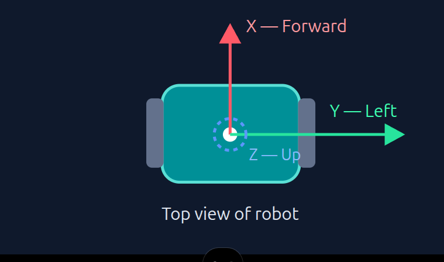
### **Important frames**

|Frame|Description|
|---|---|
|`map`|Global reference frame, corrected by localization|
|`odom`|Continuous local reference frame, subject to drift|
|`base_link`|Main robot body frame|
|`sensor_demo`|Frame attached to a sensor|
|`left_wheel_link`|Left wheel coordinate frame|
|`right_wheel_link`|Right wheel coordinate frame|

### **TF tree**

Our robot's frame relationships are:

```text
odom
 └── base_link
      ├── left_wheel_link
      ├── right_wheel_link
      └── sensor_demo
```

Later, when we implement localization:

```text
map
 └── odom
      └── base_link
           ├── left_wheel_link
           ├── right_wheel_link
           └── sensor_demo
```

Each child frame has one parent in the TF tree.

## **3. Static vs. dynamic transforms**

|Static transform|Dynamic transform|
|---|---|
|Fixed relationship|Changes over time|
|Example: `base_link → lidar_link`|Example: `odom → base_link`|
|Usually published once|Published repeatedly|
|Uses `/tf_static`|Uses `/tf`|
|Suitable for fixed sensor mounts|Suitable for moving robots and joints|

**Important:** A sensor permanently attached to the robot normally uses a static transform or a fixed URDF joint. Its transform relative to `base_link` stays constant even when the robot moves.

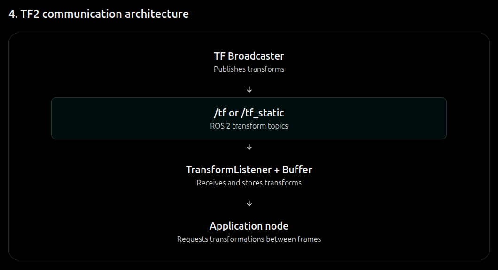

### **Main components**

**TransformBroadcaster:** Publishes dynamic transformations.

**StaticTransformBroadcaster:** Publishes fixed transformations.

**TransformListener:** Subscribes to transform data.

**Buffer:** Stores transform history and supports coordinate lookups.

**TransformStamped:** Message containing parent frame, child frame, timestamp, translation, and rotation.

### **Important topics**

```bash
ros2 topic list | grep tf
```

Expected:

```text
/tf
/tf_static
```

Inspect:

```bash
ros2 topic echo /tf --once
ros2 topic echo /tf_static --once
```

## **5. Practical 1 — TF2 broadcaster**

### **Objective**

Create a Python node that publishes the transform:

```text
base_link
 └── sensor_demo
```

Sensor position:

|Axis|Offset|
|---|---|
|X|0.20 m|
|Y|0.00 m|
|Z|0.15 m|

The sensor is positioned 20 cm forward and 15 cm above the robot's origin.

### **Create the package**

```python
cd /ros2_ws/src

ros2 pkg create tf2_practice \
  --build-type ament_python \
  --dependencies rclpy tf2_ros geometry_msgs
```

### **Broadcaster Python code**

File: `tf2_practice/tf_broadcaster.py`

```python

import rclpy
from rclpy.node import Node
from geometry_msgs.msg import TransformStamped
from tf2_ros import TransformBroadcaster


class TFBroadcaster(Node):
    def __init__(self):
        super().__init__('tf_broadcaster')

        self.broadcaster = TransformBroadcaster(self)
        self.timer = self.create_timer(0.1, self.publish_tf)

    def publish_tf(self):
        t = TransformStamped()

        t.header.stamp = self.get_clock().now().to_msg()
        t.header.frame_id = 'base_link'
        t.child_frame_id = 'sensor_demo'

        t.transform.translation.x = 0.2
        t.transform.translation.y = 0.0
        t.transform.translation.z = 0.15

        t.transform.rotation.x = 0.0
        t.transform.rotation.y = 0.0
        t.transform.rotation.z = 0.0
        t.transform.rotation.w = 1.0

        self.broadcaster.sendTransform(t)


def main(args=None):
    rclpy.init(args=args)
    node = TFBroadcaster()

    try:
        rclpy.spin(node)
    except KeyboardInterrupt:
        pass
    finally:
        node.destroy_node()
        rclpy.shutdown()


if __name__ == '__main__':
    main()

```

### **Code explanation**

|Statement|Purpose|
|---|---|
|`TransformStamped()`|Creates a stamped transform message|
|`header.stamp`|Assigns the current timestamp|
|`header.frame_id`|Specifies parent frame|
|`child_frame_id`|Specifies child frame|
|`translation`|Specifies position offset in meters|
|`rotation`|Specifies orientation as quaternion|
|`sendTransform()`|Publishes transform|
|`create_timer(0.1, ...)`|Calls function every 0.1 seconds (10 Hz)|

We used a dynamic broadcaster for learning. In industry, a fixed sensor would normally use a static broadcaster or `robot_state_publisher`.

## **6. Practical 2 — TF2 listener**

### **Objective**

Read the robot's current position relative to `odom`.

### **Listener Python code**

File: `tf2_practice/tf_listener.py`

```python

import rclpy
from rclpy.node import Node
from tf2_ros import Buffer, TransformListener
from tf2_ros import TransformException


class TFListenerNode(Node):
    def __init__(self):
        super().__init__('tf_listener_node')

        self.buffer = Buffer()
        self.listener = TransformListener(
            self.buffer, self
        )

        self.timer = self.create_timer(1.0, self.read_tf)

    def read_tf(self):
        try:
            t = self.buffer.lookup_transform(
                'odom',
                'base_link',
                rclpy.time.Time()
            )

            x = t.transform.translation.x
            y = t.transform.translation.y
            z = t.transform.translation.z

            self.get_logger().info(
                f'Robot position: '
                f'x={x:.2f}, y={y:.2f}, z={z:.2f}'
            )

        except TransformException as ex:
            self.get_logger().warn(str(ex))


def main(args=None):
    rclpy.init(args=args)
    node = TFListenerNode()

    try:
        rclpy.spin(node)
    except KeyboardInterrupt:
        pass
    finally:
        node.destroy_node()
        rclpy.shutdown()


if __name__ == '__main__':
    main()

```

### **Important function:** `lookup_transform()`

```text
transform = buffer.lookup_transform(    target_frame,    source_frame,    time)
```

For our robot:

```python
lookup_transform(    'odom',    'base_link',    rclpy.time.Time())
```

This asks:

**Where is the robot's** `base_link` **relative to the** `odom` **frame?**

`rclpy.time.Time()` requests the latest available transform.

### **Build and run**

Register these commands in `setup.py`:

```python
entry_points={    'console_scripts': [        'tf_broadcaster = tf2_practice.tf_broadcaster:main',        'tf_listener = tf2_practice.tf_listener:main',    ],},
```

Build:

```bash
cd /ros2_ws
colcon build --packages-select tf2_practice
source install/setup.bash
```

Run broadcaster:

```bash
ros2 run tf2_practice tf_broadcaster \
  --ros-args -p use_sim_time:=true
```

Run listener in another terminal:

```bash
ros2 run tf2_practice tf_listener \
  --ros-args -p use_sim_time:=true
```

The listener prints the robot's position. X and Y change when the robot moves.

**Practical result:** Both broadcaster and listener worked successfully.

## **7. Practical 3 — Transforming a point from sensor to robot**

### **Objective**

Convert an obstacle's position from `sensor_demo` to `base_link`.

Given:

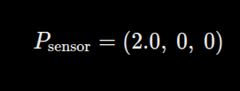

Sensor offset:

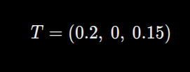

Because the sensor has no rotation relative to `base_link`:

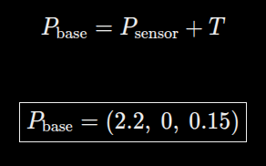
### **Python implementation**

Install the dependency:

```bash
sudo apt install ros-humble-tf2-geometry-msgs
```

File: `tf2_practice/transform_point.py`

```python

import rclpy
from rclpy.node import Node
from geometry_msgs.msg import PointStamped
from tf2_ros import Buffer, TransformListener
from tf2_ros import TransformException
from tf2_geometry_msgs import do_transform_point


class PointTransformer(Node):
    def __init__(self):
        super().__init__('point_transformer')

        self.buffer = Buffer()
        self.listener = TransformListener(
            self.buffer, self
        )

        self.timer = self.create_timer(
            1.0, self.transform_point
        )

    def transform_point(self):
        point = PointStamped()

        point.header.frame_id = 'sensor_demo'

        point.point.x = 2.0
        point.point.y = 0.0
        point.point.z = 0.0

        try:
            transform = self.buffer.lookup_transform(
                'base_link',
                'sensor_demo',
                rclpy.time.Time()
            )

            point.header.stamp = transform.header.stamp

            result = do_transform_point(
                point, transform
            )

            self.get_logger().info(
                f'Obstacle in base_link: '
                f'x={result.point.x:.2f}, '
                f'y={result.point.y:.2f}, '
                f'z={result.point.z:.2f}'
            )

        except TransformException as ex:
            self.get_logger().warn(str(ex))


def main(args=None):
    rclpy.init(args=args)
    node = PointTransformer()

    try:
        rclpy.spin(node)
    except KeyboardInterrupt:
        pass
    finally:
        node.destroy_node()
        rclpy.shutdown()


if __name__ == '__main__':
    main()

```

Register in `setup.py`:

```text
'transform_point = tf2_practice.transform_point:main',
```

Add to `package.xml`:

```text
<exec_depend>tf2_geometry_msgs</exec_depend>
```

Build and run:

```bash
cd /ros2_ws
colcon build --packages-select tf2_practice
source install/setup.bash

ros2 run tf2_practice transform_point \
  --ros-args -p use_sim_time:=true
```

Expected:

```text
Obstacle in base_link: x=2.20, y=0.00, z=0.15
```

### **Important ROS 2 message types**

|Message|Purpose|
|---|---|
|`Point`|Represents an XYZ position|
|`PointStamped`|Point with frame ID and timestamp|
|`Transform`|Translation and rotation|
|`TransformStamped`|Transform with parent, child and timestamp|
|`Twist`|Linear and angular velocity|
|`TwistStamped`|Velocity with timestamp and frame ID|

**Practical result:** Point transformation worked successfully.

## **8. Rotation and quaternion fundamentals**

### **Why is rotation important?**

Simple addition works only when two coordinate frames have the same orientation.

If a robot turns 90°, an obstacle directly in front of it no longer lies along the original odometry X axis.

The general transformation equation is:
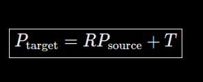

Where:

- \(R\): Rotation matrix
    
- \(T\): Translation vector
    
- \(P_{\text{source}}\): Original point
    
- \(P_{\text{target}}\): Transformed point
    

### **2D rotation matrix**
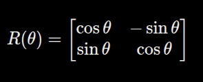

For a 90° counterclockwise rotation:

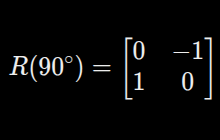

### **Example**

Robot position:

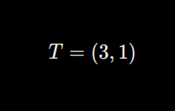

Robot orientation:

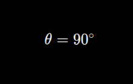

Obstacle relative to robot:

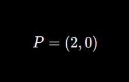

Applying the transformation:

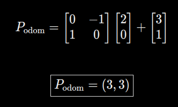

### **What is a quaternion?**

A quaternion represents 3D orientation using four values:

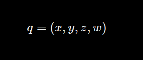

For a robot rotating only around its Z axis:
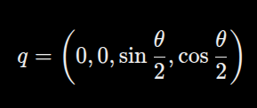

|Rotation|Quaternion (x, y, z, w)|
|---|---|
|0°|(0, 0, 0, 1)|
|90°|(0, 0, 0.7071, 0.7071)|
|180°|(0, 0, 1, 0)|
|270°|(0, 0, 0.7071, -0.7071)|

Quaternions are used because they represent 3D rotations without the gimbal-lock problem associated with Euler-angle representations.

## **9. Practical 4 — Transforming obstacle coordinates into** `odom`

### **Objective**

Find the position of an obstacle relative to the odometry frame while the robot moves.

Our transformation chain is:

```text
odom
 └── base_link
      └── sensor_demo
           └── Obstacle
```

TF2 automatically combines:

1. `odom → base_link`
    
2. `base_link → sensor_demo`
    

to calculate the obstacle's coordinates in `odom`.

### **Python implementation**

File: `tf2_practice/obstacle_in_odom.py`

```python

import rclpy
from rclpy.node import Node
from geometry_msgs.msg import PointStamped
from tf2_ros import Buffer, TransformListener
from tf2_ros import TransformException
from tf2_geometry_msgs import do_transform_point


class ObstacleInOdom(Node):
    def __init__(self):
        super().__init__('obstacle_in_odom')

        self.buffer = Buffer()
        self.listener = TransformListener(
            self.buffer, self
        )

        self.timer = self.create_timer(
            1.0, self.calculate
        )

    def calculate(self):
        point = PointStamped()
        point.header.frame_id = 'sensor_demo'

        # Obstacle 2 meters ahead of sensor
        point.point.x = 2.0
        point.point.y = 0.0
        point.point.z = 0.0

        try:
            transform = self.buffer.lookup_transform(
                'odom',
                'sensor_demo',
                rclpy.time.Time()
            )

            point.header.stamp = transform.header.stamp

            result = do_transform_point(
                point, transform
            )

            self.get_logger().info(
                f'Obstacle in odom: '
                f'x={result.point.x:.2f}, '
                f'y={result.point.y:.2f}, '
                f'z={result.point.z:.2f}'
            )

        except TransformException as ex:
            self.get_logger().warn(str(ex))


def main(args=None):
    rclpy.init(args=args)
    node = ObstacleInOdom()

    try:
        rclpy.spin(node)
    except KeyboardInterrupt:
        pass
    finally:
        node.destroy_node()
        rclpy.shutdown()


if __name__ == '__main__':
    main()
```

Register in `setup.py`:
```text
'obstacle_in_odom = tf2_practice.obstacle_in_odom:main',
```

Build:

```bash
cd /ros2_ws
colcon build --packages-select tf2_practice
source install/setup.bash
```

Run:

```bash
ros2 run tf2_practice obstacle_in_odom \
  --ros-args -p use_sim_time:=true
```

### **Expected behavior**

When the robot is initially at the odometry origin, facing forward:

```text
Obstacle in odom: x=2.20, y=0.00, z=0.15
```

When the robot moves forward, X changes.

When the robot rotates, both X and Y can change.

**Important distinction:** This practical simulates an obstacle that always remains 2 meters ahead of the sensor. It does not track a stationary real-world obstacle.

In an actual LiDAR system, sensor measurements change as the robot moves. Each measurement should be transformed using the robot's pose at the measurement timestamp.

**Practical result:** The obstacle coordinates updated correctly while the robot moved and rotated.

## **10. Moving the robot using ROS 2 commands**

In ROS 2 Humble, the `diff_drive_controller` chooses its command topic from the `use_stamped_vel` parameter:

|`use_stamped_vel`|Topic|Message type|
|---|---|---|
|`false` (our configuration)|`/diff_drive_controller/cmd_vel_unstamped`|`geometry_msgs/msg/Twist`|
|`true`|`/diff_drive_controller/cmd_vel`|`geometry_msgs/msg/TwistStamped`|

Verified working controller interface

**Topic:** `/diff_drive_controller/cmd_vel_unstamped`

**Message type:** `geometry_msgs/msg/Twist`

### **Move forward**

```bash
ros2 topic pub -r 10 /diff_drive_controller/cmd_vel_unstamped \
geometry_msgs/msg/Twist \
'{linear: {x: 0.3}, angular: {z: 0.0}}'
```

### **Rotate left**

```bash
ros2 topic pub -r 10 /diff_drive_controller/cmd_vel_unstamped \
geometry_msgs/msg/Twist \
'{linear: {x: 0.0}, angular: {z: 0.5}}'
```

### **Rotate right**

```bash
ros2 topic pub -r 10 /diff_drive_controller/cmd_vel_unstamped \
geometry_msgs/msg/Twist \
'{linear: {x: 0.0}, angular: {z: -0.5}}'
```

### **Move in a curve**

```bash
ros2 topic pub -r 10 /diff_drive_controller/cmd_vel_unstamped \
geometry_msgs/msg/Twist \
'{linear: {x: 0.3}, angular: {z: 0.3}}'
```

### **Stop**

Press `Ctrl+C` to stop publishing.

Your controller's previously verified `cmd_vel_timeout` was 0.5 seconds, so it should stop shortly after receiving no further commands.

For an explicit stop:

```bash
ros2 topic pub --once /diff_drive_controller/cmd_vel_unstamped \
geometry_msgs/msg/Twist \
'{linear: {x: 0.0}, angular: {z: 0.0}}'
```

### **Understanding velocity commands**

|Parameter|Meaning|Unit|
|---|---|---|
|`linear.x`|Forward/backward velocity|m/s|
|`linear.y`|Sideways velocity (not used by differential drive)|m/s|
|`angular.z`|Turning velocity|rad/s|
|`-r 10`|Publish 10 times per second|Hz|

A positive `angular.z` turns the robot left. A negative value turns it right.

### **Twist vs TwistStamped**

`Twist` contains only linear and angular velocity. `TwistStamped` wraps a `Twist` with a header (timestamp and frame ID).

In ROS 2 Humble, `diff_drive_controller` supports both, selected by `use_stamped_vel`. We use plain `Twist` (`use_stamped_vel: false`) because it is the simplest option and is what `teleop_twist_keyboard` publishes in Humble. Stamped commands are mainly useful when you need the controller to ignore stale commands based on their timestamp.

## **11. TF2 debugging and troubleshooting**

These commands are useful throughout ROS 2 development.

### **Essential debugging commands**

|Command|Purpose|
|---|---|
|`ros2 topic list -t`|List topics and message types|
|`ros2 topic echo /tf --once`|Inspect dynamic transforms|
|`ros2 topic echo /tf_static --once`|Inspect static transforms|
|`ros2 run tf2_tools view_frames`|Generate TF tree diagram|
|`ros2 run tf2_ros tf2_echo odom base_link`|Inspect robot pose transform|
|`ros2 run tf2_ros tf2_monitor odom base_link`|Inspect transform timing|
|`ros2 control list_controllers`|Check controller states|
|`ros2 topic hz /diff_drive_controller/odom`|Check odometry frequency|

### **Generate the TF tree**

```bash
ros2 run tf2_tools view_frames
```

Open the generated PDF:

```text
xdg-open frames.pdf
```

### **Check the robot's transform**

```bash
ros2 run tf2_ros tf2_echo odom base_link
```

The translation and rotation should change as the robot moves.

### **Check simulation time**

```bash
ros2 param get /diff_drive_controller use_sim_time
ros2 param get /obstacle_in_odom use_sim_time
```

Expected:

```text
Boolean value is: True
```

When using Gazebo simulation time, relevant nodes must use a consistent time source.

### **Common TF2 errors**

|Error|Meaning|Solution|
|---|---|---|
|`LookupException`|Frame cannot be found|Verify frame names and publishers|
|`ConnectivityException`|Frames are disconnected|Inspect TF tree|
|`ExtrapolationException`|Requested transform time is unavailable|Check timestamps and buffer history|
|TF not updating|Simulation paused or publisher stopped|Check Gazebo and nodes|
|Incorrect obstacle position|Wrong frame offset or orientation|Verify transform values|
|Robot not moving|Wrong velocity topic or inactive controller|Check topic subscribers and controller status|
|Duplicate transforms|Multiple publishers for same frame relationship|Use one authoritative publisher|

### **Important issue encountered during this lesson**

A robot may fail to move if you publish to the wrong command topic. With `use_stamped_vel: false` the controller listens on `cmd_vel_unstamped` (`Twist`), while with `use_stamped_vel: true` it listens on `cmd_vel` (`TwistStamped`).

**Lesson learned:** Never assume the controller's topic name or message type.

Always inspect the actual ROS graph:

```bash
ros2 topic list -t | grep cmd_vel
```

```bash
ros2 topic info /diff_drive_controller/cmd_vel_unstamped -v
```

Also verify that Gazebo is unpaused. A paused simulation can stop clock progression, controller updates, and odometry.

---

---

[Next: ros2_control](./ros2-control.md)
