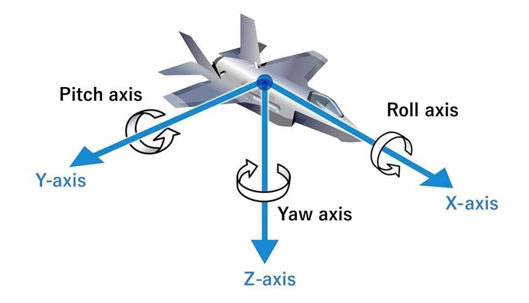
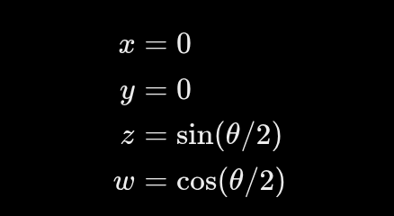
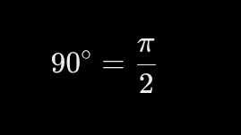
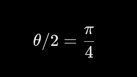
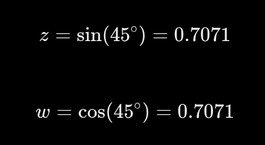

# Dynamic TF Broadcaster in ROS 2

In the previous lesson, we published a fixed transformation:

```text
base_link → laser_link
```

The LiDAR's position relative to the robot body never changed.

Now we'll learn dynamic transformations, where the position or orientation changes continuously.

## 1. What is a dynamic transformation?

Imagine your robot moving forward and turning.

Its position relative to the world changes continuously:

```text
world → base_link
```

For example:

- At 1 second: Robot is at X = 0.0 m.
    
- At 2 seconds: Robot is at X = 0.5 m.
    
- At 3 seconds: Robot is at X = 1.0 m.
    

TF2 allows other ROS 2 nodes to track these changes.

## 2. Create a dynamic TF broadcaster

We'll create a simple robot simulation that moves forward continuously.

Use your Ubuntu laptop.

### Step 1: Create the Python file

```bash
cd ~/ros2_ws/src/robot_basics/robot_basics
touch dynamic_tf_broadcaster.py
```

Open it:

```bash
nano dynamic_tf_broadcaster.py
```

### Step 2: Add the code

```python

import math
import rclpy

from rclpy.node import Node
from geometry_msgs.msg import TransformStamped
from tf2_ros import TransformBroadcaster


class DynamicTFBroadcaster(Node):

    def __init__(self):
        super().__init__('dynamic_tf_broadcaster')

        self.broadcaster = TransformBroadcaster(self)

        self.x = 0.0
        self.y = 0.0
        self.angle = 0.0

        self.timer = self.create_timer(
            0.1,
            self.publish_transform
        )

    def publish_transform(self):

        transform = TransformStamped()

        transform.header.stamp = self.get_clock().now().to_msg()

        transform.header.frame_id = 'odom'
        transform.child_frame_id = 'base_link'

        # Update robot position
        self.x += 0.05
        self.angle += 0.02

        transform.transform.translation.x = self.x
        transform.transform.translation.y = self.y
        transform.transform.translation.z = 0.0

        # Convert yaw angle into quaternion
        transform.transform.rotation.x = 0.0
        transform.transform.rotation.y = 0.0
        transform.transform.rotation.z = math.sin(self.angle / 2)
        transform.transform.rotation.w = math.cos(self.angle / 2)

        self.broadcaster.sendTransform(transform)

        self.get_logger().info(
            'Robot X position: %.2f' % self.x
        )


def main(args=None):

    rclpy.init(args=args)

    node = DynamicTFBroadcaster()

    rclpy.spin(node)

    node.destroy_node()

    rclpy.shutdown()


if __name__ == '__main__':
    main()

```

### Step 3: Add the executable

Open your existing `setup.py`:

```bash
nano ~/ros2_ws/src/robot_basics/setup.py
```

Add this entry inside the existing `console_scripts` list:

```text
'dynamic_tf'
```

Keep your existing entries.

### Step 4: Build the package

```bash
cd ~/ros2_ws
colcon build --packages-select robot_basics
source install/setup.bash
```

### Step 5: Run the broadcaster

```bash
ros2 run robot_basics dynamic_tf_broadcaster
```

Expected output:

```text
Robot X position: 0.05
Robot X position: 0.10
Robot X position: 0.15
Robot X position: 0.20
...
```

The robot's X position increases continuously.

## 3. Verify the dynamic transformation

Open a second terminal.

Run:

```bash
ros2 run tf2_ros tf2_echo odom base_link
```

You should see the translation changing continuously:

```text
Translation:
  x: 0.5
  y: 0.0
  z: 0.0
```

After a little while, the X value will be larger.

The rotation will also change because we are gradually increasing the yaw angle.

## 4. Understand the important code

|Code|Purpose|
|---|---|
|`TransformBroadcaster(self)`|Creates a dynamic TF broadcaster|
|`create_timer(0.1, ...)`|Calls the function every 0.1 seconds|
|`odom`|Parent coordinate frame|
|`base_link`|Robot body frame|
|`self.x += 0.05`|Moves the robot forward in X|
|`math.sin()` and `math.cos()`|Convert yaw angle into quaternion values|

Static vs Dynamic TF

|Static TF|Dynamic TF|
|---|---|
|Fixed transformation|Changes over time|
|Uses `StaticTransformBroadcaster`|Uses `TransformBroadcaster`|
|Example: body to LiDAR|Example: odometry to robot body|

Your practical task

1. Run the dynamic broadcaster.
    
2. Open another terminal.
    
3. Run `tf2_echo odom base_link`.
    
4. Confirm that the X position changes continuously.
    

Important: Stop your previous static broadcaster before testing this if you are still running it. Keep the dynamic broadcaster running in one terminal and use the second terminal for `tf2_echo`.

Once this works, we'll learn how to visualize the TF tree in RViz2 and inspect it using `view_frames`.

---

A quaternion is a mathematical way of representing the orientation (rotation) of a robot or object in 3D space.

In ROS 2, quaternions are used to describe how a robot, camera, LiDAR, or any other component is rotated.

Let's understand it step by step.

## 1. Why do we need a quaternion?

Imagine a robot standing on the floor.

Initially, it faces forward. Now suppose it turns 90° to the left.

We need a way to represent this rotation.

For a 2D robot moving on a flat floor, we mainly need three values:

- Roll: Rotation around X-axis.
    
- Pitch: Rotation around Y-axis.
    
- Yaw: Rotation around Z-axis.
    

[Yaw Pitch Roll Order at Everett Reynolds blog](https://images.openai.com/static-rsc-4/xT_ClKBi5nIzlpSPnwAXbCkHjuk5K1ZGdkLs9zDa9F1Jbu39zlWICD5xNVZbIiHW1JntjuXtWoLN4XLcgLIH-mGu2ZkSAG0VJs4mCr7tuRmiM0opyab1qW6ugJMQ3PBUvnCesz5nUPwcG40_ZPoKIJlvsb8XB62F4ZSUkxwzOHg?purpose=inline)

[storage.googleapis.com](https://storage.googleapis.com/dkkrzunmcceqhe/yaw-pitch-roll-order.html)

For a differential-drive robot:

- Roll is usually zero.
    
- Pitch is usually zero.
    
- Yaw changes when the robot turns left or right.
    

We could represent the rotation using Euler angles (roll, pitch, yaw). However, ROS 2 uses quaternions for representing 3D orientation.

## 2. What is a quaternion?

A quaternion consists of four values:

\[ q = (x,y,z,w) \]

In ROS 2, you will commonly see:

```python
transform.transform.rotation.x
transform.transform.rotation.y
transform.transform.rotation.z
transform.transform.rotation.w
```

These four values together represent one rotation.

Important: Quaternion values are not simply X, Y, Z rotation angles. They are mathematical components used to encode the rotation.

## 3. Understand using an example

In your dynamic TF broadcaster, you have:

```python
transform.transform.rotation.x = 0.0
transform.transform.rotation.y = 0.0
transform.transform.rotation.z = math.sin(self.angle / 2)
transform.transform.rotation.w = math.cos(self.angle / 2)
```

Why?

Because our robot rotates only around the Z-axis (yaw).

For a rotation around the Z-axis:



Here, \(\theta\) is the yaw angle in radians.

## 4. Calculate a quaternion for 90° rotation

Suppose the robot rotates 90°.

First, convert degrees into radians:



Then divide the angle by 2:



Calculate:




Therefore, the quaternion is:

## (0, 0, 0.7071, 0.7071)

Quaternion (x, y, z, w) for a 90° yaw rotation

In Python:

```python
transform.transform.rotation.x = 0.0
transform.transform.rotation.y = 0.0
transform.transform.rotation.z = 0.7071
transform.transform.rotation.w = 0.7071
```

## 5. Why do we divide the angle by 2?

This is part of the mathematical definition of quaternion rotation.

For a rotation of angle \(\theta\), the quaternion uses:

![[Pasted image 20261110103345.png]]

You don't need to derive this mathematically right now. Just remember the formula for a rotation around the Z-axis:

```python
z = math.sin(angle / 2)
w = math.cos(angle / 2)
```

## 6. Common quaternion examples

|Rotation|x|y|z|w|
|---|---|---|---|---|
|0°|0|0|0|1|
|90° yaw|0|0|0.7071|0.7071|
|180° yaw|0|0|1|0|
|270° yaw|0|0|0.7071|-0.7071|

The table assumes rotation around the Z-axis.

## 7. Try it yourself in Python

You can calculate quaternion values without running ROS 2.

```python
import math

angle = math.radians(90)

x = 0.0
y = 0.0
z = math.sin(angle / 2)
w = math.cos(angle / 2)

print("Quaternion:")
print(x, y, z, w)
```

Output:

```text
Quaternion:
0.0 0.0 0.7071067811865475 0.7071067811865476
```

---

[Next: Visualizing TF2 in RViz2](./rviz2.md)
