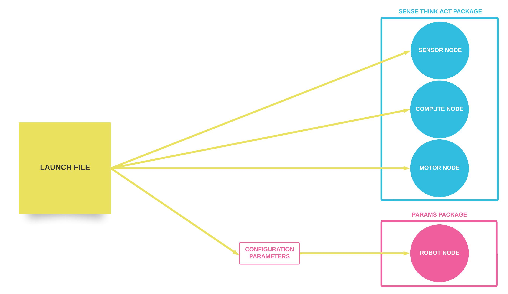

# Launch File

A launch file is a Python file that describes which ROS 2 nodes should start and how they should be configured.

[How to Use ROS 2 Launch Files | Foxglove](https://images.openai.com/static-rsc-4/dYZvioI7cv_AbtmnPic6rgPgl-WbdfJVsnsZhx6HpdCy_lOoYyxIinJd50ofopIserU65_-bFK_m_izqlr5GgaR7pFDx0fyW8gh3dfBOp2vRJmtr6pC01ZqsfqxhLH5GWLyZqK7MIwdxRF9zkEwXYBGVoOvEdsKSAL26OVZNv5U?purpose=inline)

[foxglove.dev](https://foxglove.dev/blog/how-to-use-ros2-launch-files)

For our example, one launch file will start:

- Publisher node (`talker`)
    
- Subscriber node (`listener`)
    

Instead of two terminal commands, we'll use just one.

## 1. Create a launch directory

We'll continue using your existing `robot_basics` package on your Ubuntu laptop.

```bash
cd ~/ros2_ws/src/robot_basics
```

Create a directory named `launch`:

```bash
mkdir launch
```

Your package structure should now look like this:

```text
robot_basics/
├── package.xml
├── setup.py
├── setup.cfg
├── resource/
│   └── robot_basics
├── robot_basics/
│   ├── __init__.py
│   ├── talker.py
│   ├── listener.py
│   └── parameter_demo.py
└── launch/
```

## 2. Create your first launch file

Run:

```bash
nano launch/talker_listener.launch.py
```

Paste this code:

```python
from launch import LaunchDescription
from launch_ros.actions import Node


def generate_launch_description():

    talker_node = Node(
        package='robot_basics',
        executable='talker',
        name='robot_publisher',
        output='screen'
    )

    listener_node = Node(
        package='robot_basics',
        executable='listener',
        name='robot_listener',
        output='screen'
    )

    return LaunchDescription([
        talker_node,
        listener_node
    ])
```

## 3. Understand the code

A. Import LaunchDescription

```python
from launch import LaunchDescription
```

This is used to describe everything that should be started.

B. Import Node

```python
from launch_ros.actions import Node
```

This allows us to start ROS 2 nodes from the launch file.

C. Define the publisher

```python
talker_node = Node(    package='robot_basics',    executable='talker',    name='robot_publisher',    output='screen')
```

|Property|Meaning|
|---|---|
|`package`|Package containing the node|
|`executable`|Program to execute|
|`name`|Name assigned to the node|
|`output`|Display logs in terminal|

D. Define the subscriber

We create another `Node` object for the listener.

E. Start both nodes

```python
return LaunchDescription([    talker_node,    listener_node])
```

This tells ROS 2 to launch both nodes.

## 4. Update setup.py

This is an important step. ROS 2 needs to know where your launch files are located when you install the package.

Open:

```bash
nano setup.py
```

At the top, make sure these imports are present:

```python
import osfrom glob import globfrom setuptools import find_packages, setup
```

Find the `data_files` section and add the launch directory entry:

```python
data_files=[
    ('share/ament_index/resource_index/packages',
        ['resource/robot_basics']),
    ('share/robot_basics', ['package.xml']),
    (os.path.join('share', 'robot_basics', 'launch'),
        glob('launch/*.launch.py')),
],
```

Keep your existing `entry_points` section unchanged.

## 5. Update package.xml

Open:

```bash
nano package.xml
```

Add these dependencies inside the `<package>` element:

```xml
<exec_depend>launch</exec_depend>
<exec_depend>launch_ros</exec_depend>
```

Save the file.

## 6. Build the package

Go to your workspace:

```bash
cd ~/ros2_ws
```

Build:

```bash
colcon build --packages-select robot_basics
```

Source the workspace:

```bash
source install/setup.bash
```

## 7. Run the launch file

Now comes the interesting part!

Instead of running two separate commands, execute:

```bash
ros2 launch robot_basics talker_listener.launch.py
```

Expected result

You should see both publisher and subscriber logs in the same terminal:

```text
[robot_publisher]: Publishing: "Robot is ready!"
[robot_listener]: Received: "Robot is ready!"

[robot_publisher]: Publishing: "Robot is ready!"
[robot_listener]: Received: "Robot is ready!"

[robot_publisher]: Publishing: "Robot is moving!"
[robot_listener]: Received: "Robot is moving!"
```

Press `Ctrl + C` to stop both nodes.

## 8. Useful launch commands

| Command                                              | Purpose            |
| ---------------------------------------------------- | ------------------ |
| `ros2 launch robot_basics talker_listener.launch.py` | Start launch file  |
| `ros2 node list`                                     | List running nodes |
| `ros2 topic list`                                    | List active topics |
| `ros2 topic echo /robot_status`                      |                    |

---

[Next: Introduction to TF2](./tf2.md)
