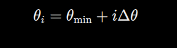
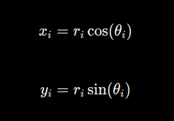
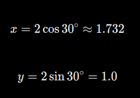

# Run and Debug the LiDAR Simulation

These are the commands to start your working simulation from a fresh terminal session.

## **Terminal 1 — Start Gazebo**

```bash
source /opt/ros/humble/setup.bash
source /ros2_ws/install/setup.bash

ign gazebo -r /ros2_ws/worlds/lidar_world.sdf
```

The `-r` flag starts the simulation running rather than paused.

## **Terminal 2 — Start robot_state_publisher**

```bash
source /opt/ros/humble/setup.bash
source /ros2_ws/install/setup.bash

ros2 run robot_state_publisher robot_state_publisher \
  --ros-args \
  -p robot_description:="$(cat /ros2_ws/src/robot_description/urdf/my_robot_generated.urdf)" \
  -p use_sim_time:=true
```

`robot_state_publisher` publishes the robot's coordinate transforms based on the robot description and joint states.

## **Terminal 3 — Spawn the robot**

```bash
source /opt/ros/humble/setup.bash
source /ros2_ws/install/setup.bash

ros2 run ros_gz_sim create \
  -world empty \
  -topic robot_description \
  -name my_robot \
  -z 0.2
```

This creates the robot inside the running Gazebo world.

The `-z 0.2` argument specifies the initial spawn height, which may need adjustment for the robot's physical geometry.

## **Terminal 4 — Activate controllers**

```bash
source /opt/ros/humble/setup.bash
source /ros2_ws/install/setup.bash

ros2 run controller_manager spawner \
  joint_state_broadcaster \
  --controller-manager /controller_manager
```

Then:

```bash
ros2 run controller_manager spawner \
  diff_drive_controller \
  --controller-manager /controller_manager
```

Verify:

```bash
ros2 control list_controllers
```

Expected:

```text
joint_state_broadcaster ... active
diff_drive_controller  ... active
```

## **Terminal 5 — Bridge Gazebo and ROS 2**

```bash
source /opt/ros/humble/setup.bash
source /ros2_ws/install/setup.bash

ros2 run ros_gz_bridge parameter_bridge \
  '/scan@sensor_msgs/msg/LaserScan[ignition.msgs.LaserScan' \
  '/clock@rosgraph_msgs/msg/Clock[ignition.msgs.Clock'
```

This forwards the LiDAR measurements and simulation clock from Gazebo to ROS 2.

Keep this terminal running.

## **Terminal 6 — Open RViz2**

```bash
source /opt/ros/humble/setup.bash
source /ros2_ws/install/setup.bash

rviz2 --ros-args -p use_sim_time:=true
```

Configure RViz2:

- Fixed Frame: `lidar_link` initially, then `odom`.
    
- Add `LaserScan`, Topic: `/scan`.
    
- Add `TF`.
    
- Add `RobotModel`.
    

## **Terminal 7 — Keyboard teleoperation**

```bash
source /opt/ros/humble/setup.bash
source /ros2_ws/install/setup.bash

ros2 run teleop_twist_keyboard teleop_twist_keyboard \
  --ros-args \
  -r /cmd_vel:=/diff_drive_controller/cmd_vel_unstamped
```

In Humble, your differential-drive controller (`use_stamped_vel: false`) accepts plain `Twist` messages on `cmd_vel_unstamped`. The remap `-r /cmd_vel:=...` redirects the keyboard node's output to that topic.


## **10. What is** `sensor_msgs/msg/LaserScan`**?**

This ROS 2 message represents range measurements taken at different angles in a scanning plane.

Inspect its definition:

```bash
ros2 interface show sensor_msgs/msg/LaserScan
```

Read a scan:

```bash
ros2 topic echo /scan --once
```

Example output (illustrative):

```yaml
header:
  stamp:
    sec: 120
    nanosec: 0
  frame_id: lidar_link

angle_min: -3.14159
angle_max: 3.14159
angle_increment: 0.01745

time_increment: 0.0
scan_time: 0.1

range_min: 0.12
range_max: 8.0

ranges:
- 2.5
- 2.4
- 2.3
- 2.2

intensities: []
```

### **Important fields**

|Field|Explanation|
|---|---|
|`header.stamp`|Timestamp of the scan|
|`header.frame_id`|Sensor coordinate frame|
|`angle_min`|Starting scan angle|
|`angle_max`|Ending scan angle|
|`angle_increment`|Angular spacing between readings|
|`scan_time`|Time between scans|
|`range_min`|Minimum valid distance|
|`range_max`|Maximum valid distance|
|`ranges`|Array of distance measurements|
|`intensities`|Optional returned signal intensities|

### **Calculating the angle of a reading**

For range index \(i\):



For a 360-sample scan covering approximately 360°, the angular spacing is roughly 1°.

### **Converting polar coordinates to Cartesian coordinates**

For each valid distance \(r_i\):


These coordinates are relative to the LiDAR sensor frame.

For example, a measurement of 2 m at 30° gives:


This is one of the basic calculations used in robotics perception.

## **11. Why are coordinate frames important?**

The LiDAR measures distances relative to its own coordinate frame.

However, RViz2 may need to display those measurements relative to the robot or the world.

Our relevant TF chain is:

```text
odom
  |
  └── base_link
        |
        └── lidar_link
```

The odometry transform changes as the robot moves.

The transform from `base_link` to `lidar_link` is fixed because the sensor is rigidly mounted.

Check:

```bash
ros2 run tf2_ros tf2_echo base_link lidar_link
```

The expected translation is approximately:

```text
Translation: [0.0, 0.0, 0.2]
```

This assumes the sensor mounting position from our URDF example.

### **RViz2 Fixed Frame**

|Fixed Frame|What it means|
|---|---|
|`lidar_link`|Visualize measurements relative to the sensor|
|`base_link`|Visualize relative to the robot body|
|`odom`|Visualize relative to the odometry frame|
|`map`|Visualize relative to a map, once SLAM or localization provides it|

For initial LiDAR testing, `lidar_link` is convenient because it avoids requiring additional TF transforms.

For moving-robot visualization, `odom` is more useful.


## **12. Errors we encountered and their solutions**

|Problem|Cause|Solution|
|---|---|---|
|`/scan` missing|Gazebo sensor system not active|Add `ignition-gazebo-sensors-system`|
|`model://ground_plane` missing|Resource URI could not be resolved|Define ground directly in SDF|
|`model://sun` missing|Resource URI could not be resolved|Define directional light in SDF|
|`ignition_frame_id` warning|Element not recognized by the SDF schema validator|Check sensor frame handling; warning was not fatal|
|Robot not visible|Robot not spawned or publisher unavailable|Start publisher, then spawn|
|Controllers inactive|Controllers not spawned or configured|Use controller spawner|
|RViz2 scan not visible|Missing TF, wrong Fixed Frame, or missing bridge|Check frame, `/scan`, and TF|
|Scan not updating|Simulation paused or sensor not updating|Resume Gazebo and check sensor topics|

### **Essential diagnostic commands**

```bash
# List Gazebo topics
ign topic -l

# List models in Gazebo
ign model --list

# Check Gazebo LiDAR data
ign topic -e -t /scan

# List ROS 2 topics
ros2 topic list

# Check ROS 2 LiDAR data
ros2 topic echo /scan --once

# Check LiDAR frequency
ros2 topic hz /scan

# Check active controllers
ros2 control list_controllers

# Check LiDAR TF
ros2 run tf2_ros tf2_echo base_link lidar_link

# Check odometry
ros2 topic echo /diff_drive_controller/odom --once

# Check simulation clock
ros2 topic echo /clock --once
```

### **Recommended debugging order**

1. Is Gazebo running and unpaused?
2. Is my_robot spawned?
3. Does the URDF contain the LiDAR sensor?
4. Is the Gazebo Sensors system loaded?
5. Does ign topic -l show /scan?
6. Does ign topic -e -t /scan produce data?
7. Is ros_gz_bridge running?
8. Does ROS 2 receive /scan?
9. Are the TF frames connected?
10. Does RViz2 display the scan?

**Industry practice:** Debug from the data source toward the consumer. Verify Gazebo first, then the bridge, then ROS 2, then TF and RViz2. This helps isolate failures efficiently.


## **13. Where is this used in industry?**

[HECTOR - Robot AMR autonome longue autonomie et IP68 | AI Robotics France](https://images.openai.com/static-rsc-4/AH4SzlED7v5Zsxd61fFDquoIIZkq4mss2oWwUVVbwjOkekn3lFGxxyuUsGek7cOsxcZII_Gp_m5oB3Lj_RQtXupmgDUWbsgoLxWnZUHfOD8SQE4ujrqOoGazHeTh1QWzytXKidOeHlWaX--NzynOb3oROulNeXX3vRqC6RKhrgk?purpose=inline)

**Autonomous Mobile Robots (AMRs)**

LiDAR supports localization, mapping, and obstacle detection in warehouses and factories.

[Different SLAM approaches from “the box” in reality. | by Love Robots to Death | Medium](https://images.openai.com/static-rsc-4/mF6p7E8dGxZTaEheFSyBS0pB6YMQ4qZsgGr397Xwcf2d4UEtlujfdD-IsbH78NUHRBIYr7UBMzYlZG5ut7dikezcn2pAmnjoicXyTJH486yxh4rhqcGWtmOUTJd8WTeQv10WqTVgFbVLUsDANxLme66JohVxUMvsf1Yt1UydBXg?purpose=inline)

**SLAM systems**

LiDAR scans and odometry are combined to build maps and estimate robot position in previously unknown environments.

[Serve Gen3 by Serve Robotics — ui44](https://images.openai.com/static-rsc-4/Zm6_uoRAOurQREn709PTyautqhm5TZjINFnFIqtTVuVQGRTQ_RhHhGWwfN5J-V3buz2W4eWVt77yRtopBs6JuiLurXt3c1HQWGPidzm0Ie9mzFvZQSXIfaBED3epfzgQmLd82c-kPhFd4Od7ViFxEnlOhdNpNGACjebEvpxZ01Y?purpose=inline)

**Autonomous delivery and service robots**

Range sensing helps detect nearby structures and obstacles during navigation.

### **Industry-standard ROS 2 tools**

|Tool|Purpose|
|---|---|
|Gazebo Sim|Physics and sensor simulation|
|URDF/Xacro|Robot description|
|`ros_gz_bridge`|Gazebo–ROS 2 communication|
|`robot_state_publisher`|Robot coordinate transforms|
|`tf2`|Transform management|
|RViz2|Visualization and debugging|
|`slam_toolbox`|2D SLAM|
|Nav2|Autonomous navigation|

For real industrial deployment, sensor calibration, timestamp synchronization, reliability monitoring, and appropriate safety-rated systems are also important.

# **Part 10 — Key Concepts to Remember**

1. **URDF describes the robot**, including its links, joints, and Gazebo sensor definitions.
    
2. **Gazebo simulates the sensor**, generating measurements from the virtual environment.
    
3. **The Sensors system must be active** for our GPU LiDAR configuration to work.
    
4. `/scan` **in Gazebo is not automatically** `/scan` **in ROS 2.** We need `ros_gz_bridge`.
    
5. `LaserScan` **stores ranges and angles**, not a ready-made map.
    
6. **TF connects sensor measurements to the robot's coordinate system.**
    
7. **RViz2 visualizes measurements** but does not itself generate or process LiDAR scans.
    
8. **Odometry and LiDAR complement each other:** odometry estimates robot motion, while LiDAR observes surrounding geometry.
    
9. **SLAM combines sensor observations and motion estimates** to build a map and estimate pose.
    
10. **Simulation is a development and testing tool**, but real-world deployment requires additional sensor and safety considerations.

---

[Back to the learning path](../README.md)
