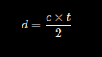
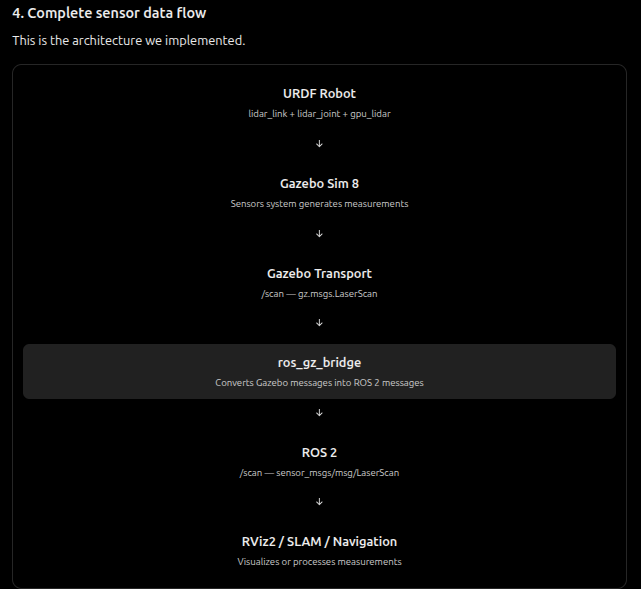

# What is LiDAR?

LiDAR stands for **Light Detection and Ranging**.

It is a sensor technology that measures the distance to surrounding objects using laser light.

[Neobotix: Mobiler Roboter MPO-500](https://images.openai.com/static-rsc-4/ozYvJDOi6xxGXFY1XyWsWINqrRvOUB4grzRyP2Msa0fY3-qhzopDdacI5N6XO9da5t8faT0QzD2dnGlas8-K5cPW3ZJEawbDLVQknF6cpQsrPwMD0GV3yIgkYgTs4xROOVAuy2AePQEU_4-fZWI-WxXFwJLk4hHzr4BwTPVNBVE?purpose=inline)

[UST-30LX | 製品一覧 | 測域センサ | データ出力タイプ | UST-30LX | 北陽電機株式会社 | 光データ装置、センサ、自動ドアなどの専門メーカー](https://images.openai.com/static-rsc-4/ysJWwgzOpuqPmV6wxh_UASm-XnWVmeBlS9ICAL-rrtDgwvT5-umZPvrM6foEDeeyEJQAlx-ec49OjROOZyve1MYn2jjowG_MeycfZrLXOvT41X3AcLQvI9Xzdx1J8lM1NCFgcJdtgfcZU6vTMdqw1q6SOvYZ7NX-VCyc6uqmdTk?purpose=inline)

[A 2D-LiDAR-Equipped Unmanned Robot-Based Approach for Indoor Human Activity Detection](https://images.openai.com/static-rsc-4/3bk-6Ax2sAQ9Emw5ffARW1RI_BnaBPYqn4ojimcqrNEhORlKh_zBRXzXuyJr7I8FC5cHA39yBkUi8LqT6YJ4--nK-updPH7OwicAiWEqzKdqjflS_3hIcdJh7v42ADNtvcLkWkSuwmQgV8qaLKZ8RjiQeGJEIvHfsyt0gXPh5PI?purpose=inline)

### **How LiDAR works**

1. The LiDAR emits laser light.
    
2. The light interacts with surrounding objects.
    
3. Reflected light returns to the sensor.
    
4. The sensor estimates the distance.
    
5. Measurements are collected across multiple directions.
    

For a time-of-flight LiDAR:

Where:

- \(d\) = distance to the object
    
- \(c\) = speed of light, approximately \(3\times10^8\) m/s
    
- \(t\) = round-trip travel time
    

The distance is divided by two because light travels from the sensor to the object and back.

### **Types of LiDAR**

|Type|Description|Application|
|---|---|---|
|2D LiDAR|Measures distances in a scanning plane|Mobile robots, SLAM|
|3D LiDAR|Produces spatial point clouds|Autonomous vehicles, mapping|
|Solid-state LiDAR|Uses limited or no macroscopic mechanical scanning|Automotive and robotics|

In our project, we simulated a **360° 2D LiDAR** using Gazebo's `gpu_lidar` sensor.

## **3. Why do robots use LiDAR?**

LiDAR helps robots understand their surroundings.

Its major applications include obstacle detection, mapping, localization, navigation, and SLAM.

For example, a warehouse robot can use LiDAR measurements to detect racks and walls, estimate its position on a map, and support obstacle-aware navigation.

LiDAR does not independently make a robot autonomous. Its measurements must be processed by localization, mapping, planning, and control software.

## **4. Complete sensor data flow**

### **Important distinction**

Gazebo and ROS 2 have separate communication systems.

|Gazebo|ROS 2|
|---|---|
|Gazebo Transport|DDS-based ROS 2 communication|
|`ignition.msgs.LaserScan`|`sensor_msgs/msg/LaserScan`|
|`ign topic -l`|`ros2 topic list`|
|`ign topic -e -t /scan`|`ros2 topic echo /scan`|

**Why is** `ros_gz_bridge` **required?**

Gazebo publishes sensor measurements using Gazebo message types. ROS 2 nodes cannot directly subscribe to those messages.

The bridge converts and forwards the messages so ROS 2 applications can use them.

---

[Next: Add a LiDAR sensor to a URDF](./lidar-urdf.md)
