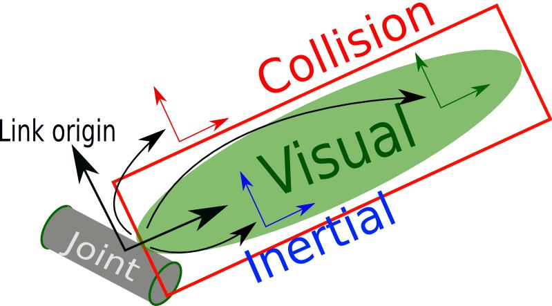
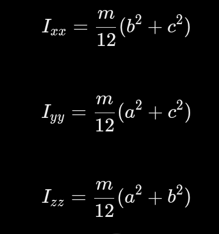

# Adding Mass, Inertia and Collision to URDF

Until now, our robot has only had a visual appearance. RViz2 can display it, but a physics simulator also needs to understand its physical properties.

We need three important elements:

1. Mass: How heavy is the robot part?
    
2. Inertia: How difficult is it to rotate the part?
    
3. Collision: What shape should the simulator use to detect physical contact?
    

[An Introduction to Understanding Visual Robot Models with URDF](https://images.openai.com/static-rsc-4/ZbYBgqrqT_2VWk63LbAewbJ_w8VHfq9firsquysKKXU66txMjA_zLd2ErnmgiEH6Zb2w9sZou8SLlarA3vwLy5ES3pSoowWgIPcY1gnj6KB-a9eQ37aHbedLjWACthGO1ADh7yPht2-efYopcF-nvY-r2IVn1RrzxoP5mHAJiM0?purpose=inline)

[linkedin.com](https://www.linkedin.com/pulse/introduction-understanding-visual-robot-models-urdf-kangal)

## 1. Visual, collision and inertial

Every physical link can have three descriptions.

|Element|Purpose|
|---|---|
|`<visual>`|Defines how the part looks|
|`<collision>`|Defines its physical boundary|
|`<inertial>`|Defines mass and rotational inertia|

For example, our robot body:

- Visual: Blue rectangular box.
    
- Collision: Rectangular box.
    
- Inertial: Mass of 2 kg and its inertia values.
    

Important: These three descriptions can use different geometries. For our beginner robot, we'll use the same box for visual and collision.

## 2. Understand mass

Mass is the quantity of matter in an object.

We will assign:

|Robot component|Mass|
|---|---|
|Main body|2 kg|
|Left wheel|0.2 kg|
|Right wheel|0.2 kg|

In URDF:

```xml
<mass value="2.0"/>
```

The unit is kilograms.

## 3. Understand inertia

Inertia describes how strongly an object resists changes in rotational motion.

For example:

- A heavy wheel is generally harder to rotate than a lighter wheel of the same shape.
    
- A mass distributed farther from the rotation axis increases rotational inertia.
    

In URDF, inertia is represented using six values:

```xml
<inertia
    ixx="..."
    ixy="..."
    ixz="..."
    iyy="..."
    iyz="..."
    izz="..."/>
```

These values form a symmetric 3D inertia matrix.

For our simple robot, we will use zero for the cross terms (`ixy`, `ixz`, `iyz`) because the chosen shapes are symmetric and aligned with their link frames.

## 4. Add physical properties to your Xacro file

Open your existing file:

```bash
cd ~/ros2_ws/src/robot_description/urdf

nano my_robot.urdf.xacro
```

Replace its contents with this updated version.

```xml

<?xml version="1.0"?>

<robot name="my_robot" xmlns:xacro="http://www.ros.org/wiki/xacro">

    <!-- Robot dimensions and masses -->

    <xacro:property name="body_length" value="0.4"/>
    <xacro:property name="body_width" value="0.3"/>
    <xacro:property name="body_height" value="0.1"/>

    <xacro:property name="wheel_radius" value="0.08"/>
    <xacro:property name="wheel_width" value="0.04"/>

    <xacro:property name="body_mass" value="2.0"/>
    <xacro:property name="wheel_mass" value="0.2"/>


    <!-- Main robot body -->

    <link name="base_link">

        <!-- Visual appearance -->

        <visual>
            <geometry>
                <box size="${body_length} ${body_width} ${body_height}"/>
            </geometry>

            <material name="blue">
                <color rgba="0.1 0.3 0.8 1"/>
            </material>
        </visual>


        <!-- Collision geometry -->

        <collision>
            <geometry>
                <box size="${body_length} ${body_width} ${body_height}"/>
            </geometry>
        </collision>


        <!-- Mass and inertia -->

        <inertial>
            <mass value="${body_mass}"/>

            <inertia
                ixx="0.016667"
                ixy="0.0"
                ixz="0.0"
                iyy="0.028333"
                iyz="0.0"
                izz="0.041667"/>
        </inertial>

    </link>


    <!-- Reusable wheel macro -->

    <xacro:macro name="wheel" params="name y_position">

        <link name="${name}">

            <!-- Visual -->

            <visual>
                <geometry>
                    <cylinder radius="${wheel_radius}" length="${wheel_width}"/>
                </geometry>

                <origin xyz="0 0 0" rpy="1.5708 0 0"/>

                <material name="black">
                    <color rgba="0.1 0.1 0.1 1"/>
                </material>
            </visual>


            <!-- Collision -->

            <collision>
                <geometry>
                    <cylinder radius="${wheel_radius}" length="${wheel_width}"/>
                </geometry>

                <origin xyz="0 0 0" rpy="1.5708 0 0"/>
            </collision>


            <!-- Mass and inertia -->

            <inertial>
                <mass value="${wheel_mass}"/>

                <inertia
                    ixx="0.000347"
                    ixy="0.0"
                    ixz="0.0"
                    iyy="0.000640"
                    iyz="0.0"
                    izz="0.000347"/>
            </inertial>

        </link>


        <!-- Wheel joint -->

        <joint name="${name}_joint" type="continuous">

            <parent link="base_link"/>
            <child link="${name}"/>

            <origin xyz="0 ${y_position} -0.08" rpy="0 0 0"/>

            <axis xyz="0 1 0"/>

        </joint>

    </xacro:macro>


    <!-- Create wheels -->

    <xacro:wheel name="left_wheel_link" y_position="0.17"/>

    <xacro:wheel name="right_wheel_link" y_position="-0.17"/>

</robot>
```

## 5. Understand the collision section

For the robot body:

```xml
<collision>
    <geometry>
        <box size="${body_length} ${body_width} ${body_height}"/>
    </geometry>
</collision>
```

This tells Gazebo that the robot body occupies a box-shaped collision area.

For the wheels:

```xml
<collision>
    <geometry>
        <cylinder radius="${wheel_radius}" length="${wheel_width}"/>
    </geometry>
    <origin xyz="0 0 0" rpy="1.5708 0 0"/>
</collision>
```

This defines cylindrical collision geometry, rotated to match the wheel's orientation.

## 6. Understand the inertia values

For a rectangular box, the inertia equations are:


Where:

- \(m\) = mass
    
- \(a\) = length
    
- \(b\) = width
    
- \(c\) = height
    

For our 2 kg body, the values are approximately:

|Inertia|Value|
|---|---|
|Ixx|0.016667|
|Iyy|0.028333|
|Izz|0.041667|

The wheel inertia values are calculated for a solid cylinder whose rotation axis is along the Y-axis of the wheel link.

These values are in kg·m².

## 7. Validate your updated Xacro

Run:

```bash
ros2 run xacro xacro my_robot.urdf.xacro -o my_robot_generated.urdf
```

Then:

```text
check_urdf my_robot_generated.urdf
```

Expected result:

```text
robot name is: my_robot
---------- Successfully Parsed XML ---------------
root Link: base_link has 2 child(ren)
```

## 8. Rebuild and visualize

Because we modified the Xacro file, rebuild the package:

```bash
cd ~/ros2_ws

colcon build --packages-select robot_description

source install/setup.bash
```

Launch:

```bash
ros2 launch robot_description display_robot.launch.py
```

Open RViz2 and check that the robot still appears and the wheel sliders work.

---

[Next: Gazebo simulation](./05-gazebo.md)
