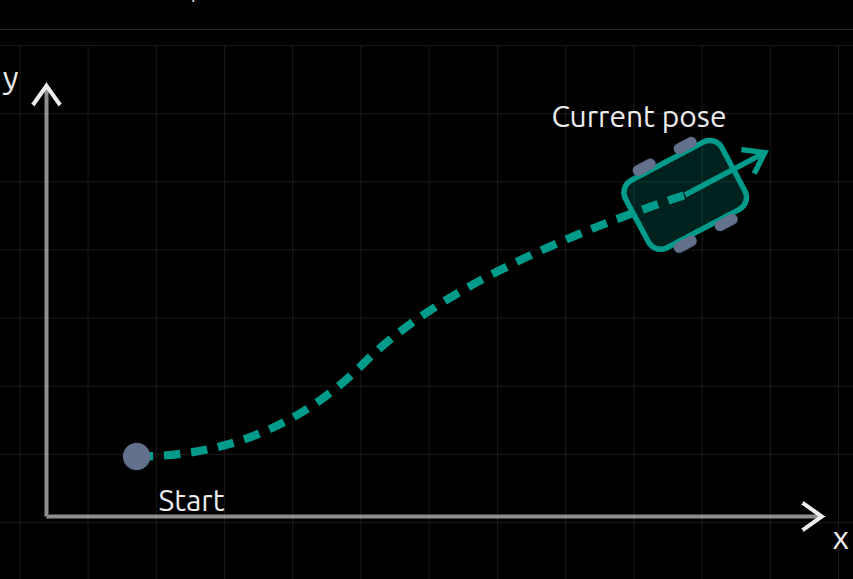
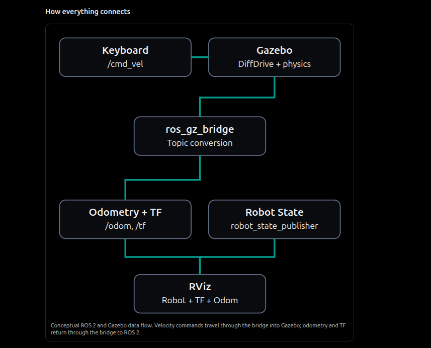

# Odometry, TF2, and RViz2 Integration

Keyboard teleoperation completed

Your robot can now move in Gazebo using ROS 2 keyboard commands. Next, we'll learn how to **track the robot's position and visualize its movement in RViz2**.

## **1. What is odometry?**

Odometry estimates how far a robot has moved and how its orientation has changed.

For a differential-drive robot, wheel rotations can be used to estimate its motion.

Illustration of a robot's estimated path from its starting position


Odometry typically provides:

- Position: `x`, `y`, `z`
    
- Orientation: quaternion
    
- Linear velocity: m/s
    
- Angular velocity: rad/s
    

An important limitation is that wheel odometry accumulates errors over time, particularly when wheels slip.

## **2. Understand TF2 frames**

For our mobile robot, the essential transformation is:

- `odom` is a locally continuous reference frame.
    
- `base_link` represents the robot body.
    
- The `odom → base_link` transform changes as the robot moves.
    

Your wheel joints and other robot links will be connected below `base_link` through `robot_state_publisher`.

## **3. Bridge odometry and TF from Gazebo to ROS 2**

Keep Gazebo and your robot running.

Open a new terminal:

```bash
source /opt/ros/humble/setup.bash

ros2 run ros_gz_bridge parameter_bridge \
  '/odom@nav_msgs/msg/Odometry[ignition.msgs.Odometry' \
  '/tf@tf2_msgs/msg/TFMessage[ignition.msgs.Pose_V'
```

Here, `[` means Gazebo → ROS 2. Note that Fortress message types start with `ignition.msgs.` (not `gz.msgs.`).

This assumes your DiffDrive plugin publishes odometry on `/odom` and transforms on `/tf`. The plugin normally publishes both unless configured otherwise.

Keep this terminal running.

## **4. Verify odometry**

In another terminal:

```bash
ros2 topic list
```

You should see `/odom` and `/tf`.

Inspect the odometry:

```bash
ros2 topic echo /odom
```

You should receive messages containing fields such as:

```text
pose:
  pose:
    position:
      x: 0.5
      y: 0.0
      z: 0.0
    orientation:
      x: 0.0
      y: 0.0
      z: 0.0
      w: 1.0
twist:
  twist:
    linear:
      x: 0.2
```

These are illustrative values, not necessarily what your robot will report.

Now drive the robot using the keyboard. Watch the `x`, `y` and orientation values change.

## **5. Verify TF2**

Run:

```bash
ros2 run tf2_ros tf2_echo odom base_link
```

This should continuously show the translation and rotation between the odometry frame and the robot body.

If the command reports that the frame does not exist, we'll check the Gazebo TF topic and the bridge configuration.

## **6. Visualize movement in RViz2**

[Robot Description - DiffBot Differential Drive Mobile Robot](https://images.openai.com/static-rsc-4/Sfw0LRqTJXY0fsZRe_KMirh4j-dXwqCRoW_AMoDHJPqlQNx8d8cbsqN5hhkVlRxCMhd3gkNSpSzrh8P1ucqeGNM5TzhJHBVxaOpFFnPXEel2JS5wOZk95RkGd3jjpikLQuU4tJ7W_I_ozbPvI8yjdTcwoDDb9uMx6op6Ulr9bJo?purpose=inline)

[ros-mobile-robots.com](https://ros-mobile-robots.com/robot-description/)

Launch RViz2:

```text
rviz2
```

Set the following:

|RViz2 setting|Value|
|---|---|
|Fixed Frame|`odom`|
|Add → TF|Display transforms|
|Add → Odometry|Topic `/odom`|
|Add → RobotModel|Use your existing robot description|

For the RobotModel display to show the complete robot correctly, you'll also need your existing `robot_state_publisher` running with the correct URDF and valid joint states.

**Important:** Gazebo's DiffDrive plugin does not automatically provide every wheel joint transform to ROS 2. We'll handle wheel joint states separately when integrating the full robot model.


---

# **ROS 2 Humble + Gazebo — Complete Terminal Setup**

Here is the complete setup to run your robot in **Gazebo Fortress**, control it using the keyboard, publish odometry and TF, and visualize it in RViz2.

We'll use your existing robot:

- Package: `robot_description`
    
- URDF: `/ros2_ws/src/robot_description/urdf/my_robot_generated.urdf`
    
- Robot name: `my_robot`
    
- Wheel controller: Gazebo DiffDrive
    

Open **7 terminals on your Ubuntu laptop**. Run the commands in order.

## **Terminal 1 — Start Gazebo**

```bash
source /opt/ros/humble/setup.bash

ign gazebo empty.sdf
```

Make sure Gazebo is unpaused (play button enabled).

## **Terminal 2 — Spawn the robot**

```bash
source /opt/ros/humble/setup.bash
source /ros2_ws/install/setup.bash

ros2 run ros_gz_sim create \
  -world empty \
  -file /ros2_ws/src/robot_description/urdf/my_robot_generated.urdf \
  -name my_robot \
  -z 0.5
```

Wait until the robot appears in Gazebo.

You can close this terminal after spawning succeeds.

## **Terminal 3 — ROS 2 ↔ Gazebo Bridge**

This terminal bridges velocity commands, odometry, and TF.

```bash
source /opt/ros/humble/setup.bash

ros2 run ros_gz_bridge parameter_bridge \
  '/cmd_vel@geometry_msgs/msg/Twist]ignition.msgs.Twist' \
  '/odom@nav_msgs/msg/Odometry[ignition.msgs.Odometry' \
  '/model/my_robot/tf@tf2_msgs/msg/TFMessage[ignition.msgs.Pose_V' \
  --ros-args \
  -r /model/my_robot/tf:=/tf
```

Keep this terminal running.

**Important:** This assumes Gazebo publishes TF on `/model/my_robot/tf`. If your actual Gazebo TF topic differs, replace that topic in the command.

## **Terminal 4 — Keyboard Teleoperation**

```bash
source /opt/ros/humble/setup.bash

ros2 run teleop_twist_keyboard teleop_twist_keyboard
```

Keyboard controls:

|Key|Movement|
|---|---|
|`i`|Forward|
|`,`|Backward|
|`j`|Rotate left|
|`l`|Rotate right|
|`k`|Stop|
|`u`|Forward-left|
|`o`|Forward-right|

## **Terminal 5 — Robot State Publisher**

This publishes the robot's URDF-based TF structure.

```bash
source /opt/ros/humble/setup.bash
source /ros2_ws/install/setup.bash

ros2 run robot_state_publisher robot_state_publisher \
  --ros-args \
  -p robot_description:="$(cat /ros2_ws/src/robot_description/urdf/my_robot_generated.urdf)"
```

Keep this terminal running.

**Note:** `robot_state_publisher` needs `/joint_states` to publish transforms for movable wheel joints. Without joint states, the chassis can still have a valid TF, but wheel link transforms may be missing.

## **Terminal 6 — RViz2**

```bash
source /opt/ros/humble/setup.bash
source /ros2_ws/install/setup.bash

rviz2
```

Configure RViz2:

|Setting|Value|
|---|---|
|Global Options → Fixed Frame|`odom`|
|Add → TF|Enabled|
|Add → Odometry|Topic `/odom`|
|Add → RobotModel|Description Source: Topic; Description Topic: `/robot_description`|

If the robot appears but its wheels are missing, we will bridge Gazebo joint states in the next lesson.

## **Terminal 7 — Verify TF and Odometry**

First, inspect the topics:

```bash
ros2 topic list
```

Expected important topics:

```text
/cmd_vel
/odom
/tf
/tf_static
/robot_description
```

Check odometry:

```bash
ros2 topic echo /odom
```

Press `Ctrl+C`, then check TF:

```bash
ros2 run tf2_ros tf2_echo odom base_link
```

You should see the robot's translation and rotation changing when you drive it.

If you still get `Invalid frame ID "odom"`, run:

```bash
ign topic -l | grep -E 'tf|odom'
```

Then verify the Gazebo TF topic is actually publishing:

```bash
ign topic -e -t /model/my_robot/tf
```

If that topic does not exist or has no messages, the bridge must be adjusted to the topic Gazebo actually publishes.


---

[Next: TF2 and coordinate transformations](./coordinate-transformations.md)
