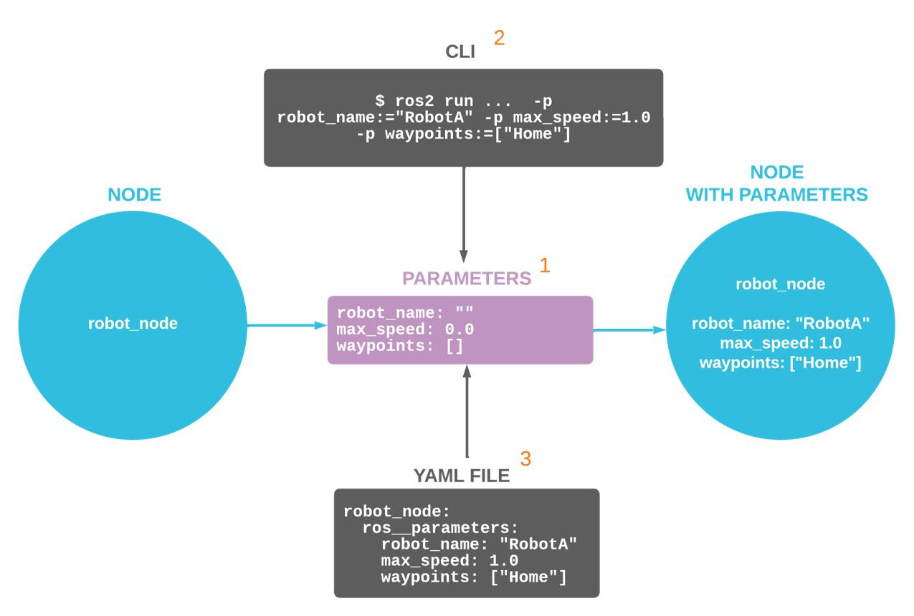

# Parameters

Parameters are used to configure a ROS 2 node while it is running, without modifying its Python source code.

For example, imagine our differential-drive robot has these settings:

- Linear speed: `0.5 m/s`
    
- Wheel radius: `0.1 m`
    
- Maximum angular speed: `1.0 rad/s`
    

Instead of hardcoding these values, we can declare them as ROS 2 parameters and change them from the terminal.

## 1. How parameters work

[How to Use ROS 2 Parameters | Foxglove](https://images.openai.com/static-rsc-4/C1gueF8Nq_qwCwMP-Fd8WlRmiqUsoxb59Jw5cPd1i9syvM2Pc6XgtK6zH6YpgB8VsLVSSkc0OsrvsaRu8wj5Skmqg6sQ9Ha7NhPc76hrv-RPWUwiiT2D3LvFsrZ5thPq7f_eZlBLX4vZH6clEUp3V9sTAfHvnk9j6UGcFyqOORM?purpose=inline)

[foxglove.dev](https://foxglove.dev/blog/how-to-use-ros2-parameters)

For example:

```bash
ros2 param set /robot_controller linear_speed 0.8
```

This changes the robot's linear speed parameter to `0.8` while the node is running.

## 2. Create a parameter demonstration

We'll use your existing `robot_basics` package on the Ubuntu laptop.

Open a terminal:

```bash
cd ~/ros2_ws/src/robot_basics/robot_basics
```

Create a file:

```bash
nano parameter_demo.py
```

Paste this code:

```python
import rclpy
from rclpy.node import Node


class RobotController(Node):

    def __init__(self):
        super().__init__('robot_controller')

        # Declare parameters
        self.declare_parameter('linear_speed', 0.5)
        self.declare_parameter('wheel_radius', 0.1)

        # Create a timer
        self.timer = self.create_timer(
            2.0,
            self.display_parameters
        )

        self.get_logger().info('Robot controller started!')

    def display_parameters(self):

        # Read parameter values
        speed = self.get_parameter('linear_speed').value
        radius = self.get_parameter('wheel_radius').value

        self.get_logger().info(
            'Linear Speed: %.2f m/s | Wheel Radius: %.2f m'
            % (speed, radius)
        )


def main(args=None):

    rclpy.init(args=args)

    node = RobotController()

    rclpy.spin(node)

    node.destroy_node()

    rclpy.shutdown()


if __name__ == '__main__':
    main()
```

### Understanding the important code

A. Declare parameters

```python
self.declare_parameter('linear_speed', 0.5)self.declare_parameter('wheel_radius', 0.1)
```

Creates two parameters with default values.

B. Read parameters

```python
speed = self.get_parameter('linear_speed').value
```

Gets the current value of `linear_speed`.

C. Timer

```python
self.timer = self.create_timer(2.0, self.display_parameters)
```

Calls the function every two seconds. This allows us to see parameter changes while the node is running.

## 3. Register the executable

Open your package's `setup.py`:

```bash
cd ~/ros2_ws/src/robot_basics
nano setup.py
```

Find `entry_points` and add:

```python
entry_points={    
  'console_scripts': [        
    'talker = robot_basics.talker:main',        
    'listener = robot_basics.listener:main',        'parameter_demo = robot_basics.parameter_demo:main',    
    ],
  },
```

Keep your existing talker and listener entries.

## 4. Build the package

```bash
cd ~/ros2_ws

colcon build --packages-select robot_basics

source install/setup.bash
```

## 5. Run the parameter node

Open Terminal 1:

```bash
ros2 run robot_basics parameter_demo
```

Expected output:

```text
Robot controller started!
Linear Speed: 0.50 m/s | Wheel Radius: 0.10 m
Linear Speed: 0.50 m/s | Wheel Radius: 0.10 m
```

Keep this terminal running.

## 6. Explore parameters using the terminal

Open Terminal 2.

A. List all parameters

```bash
ros2 param list
```

You should find:

```text
/robot_controller:
  linear_speed
  wheel_radius
```

B. Read a parameter

```bash
ros2 param get /robot_controller linear_speed
```

Expected:

```text
Double value is: 0.5
```

C. Change a parameter

```bash
ros2 param set /robot_controller linear_speed 0.8
```

Expected:

```text
Parameter set successfully
```

Look at Terminal 1. You should now see:

```text
Linear Speed: 0.80 m/s | Wheel Radius: 0.10 m
```

D. Change the wheel radius

```bash
ros2 param set /robot_controller wheel_radius 0.15
```

Terminal 1 should now display:

```text
Linear Speed: 0.80 m/s | Wheel Radius: 0.15 m
```

E. Describe a parameter

```bash
ros2 param describe /robot_controller linear_speed
```

This displays information about the parameter, including its type and description constraints.

## 7. Save parameters into a YAML file

ROS 2 also allows us to save parameters for reuse.

Run:

```bash
ros2 param dump /robot_controller
```

Save them to a file:

```bash
ros2 param dump /robot_controller > robot_params.yaml
```

This is useful when configuring different robot models or simulation environments.

---

[Next: Launch files](./launch-file.md)
