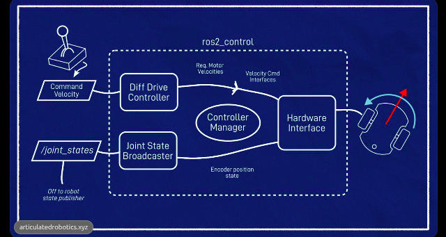
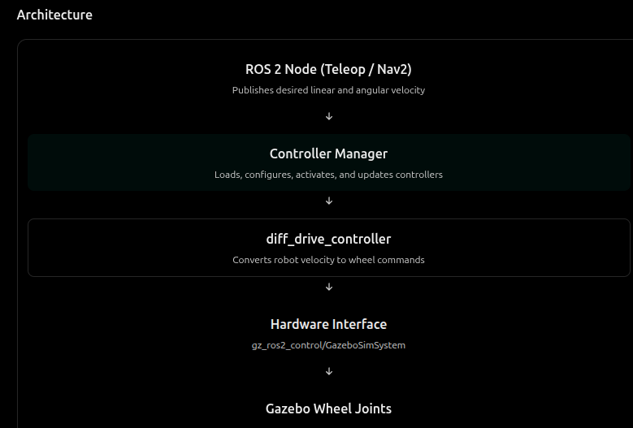
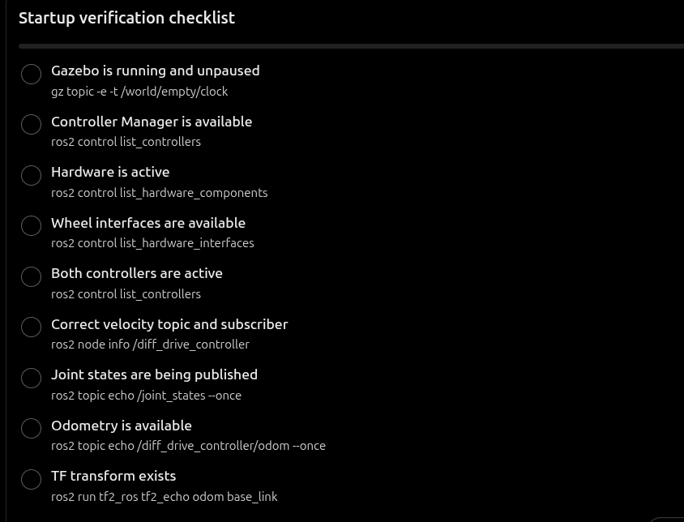
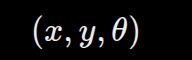
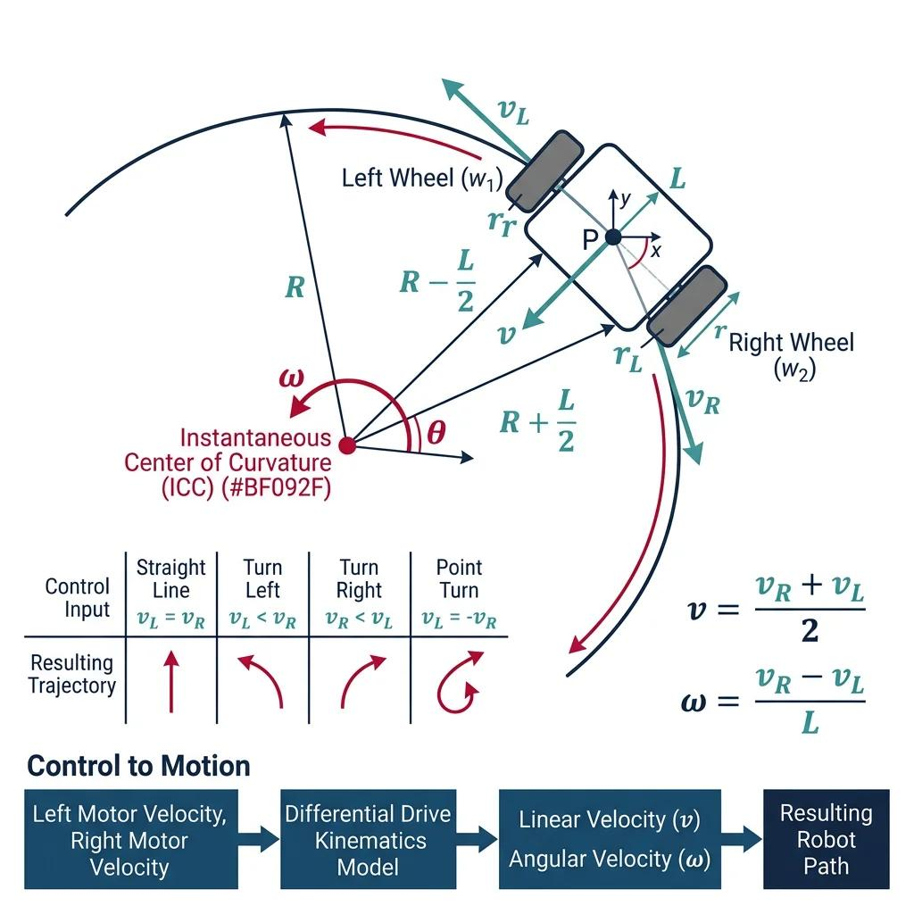
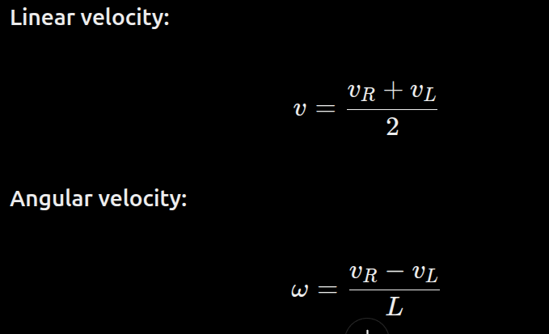
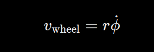
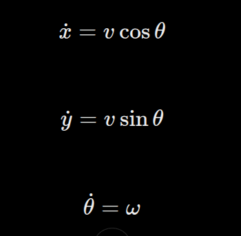
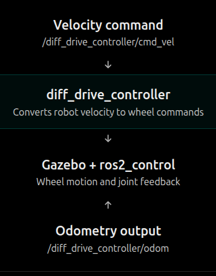
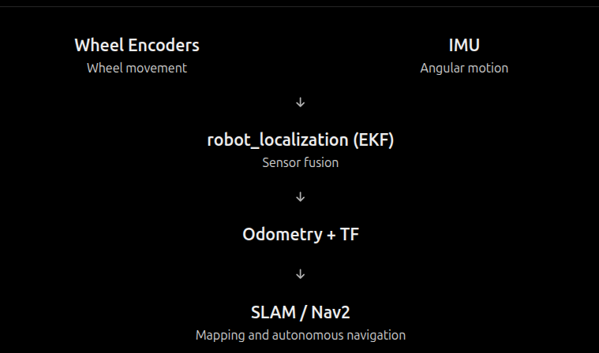

# What is `ros2_control`?

`ros2_control` is a framework that connects ROS 2 controllers to robot hardware or simulation.


It provides a standardized way to control motors, read sensors, and manage robot joints without rewriting the entire control system for different hardware.


## **2. Important components**

|Component|Purpose|
|---|---|
|`controller_manager`|Manages the lifecycle and execution of controllers|
|`ros2_control` URDF tag|Declares hardware, joints, and interfaces|
|`ign_ros2_control`|Connects ROS 2 control to Gazebo physics|
|`joint_state_broadcaster`|Publishes joint positions and velocities|
|`diff_drive_controller`|Controls two independently driven wheels|
|`controllers.yaml`|Configures controller types and parameters|
|`robot_state_publisher`|Publishes robot link transforms using URDF and joint states|

### **Install the Humble packages**

```bash
sudo apt update
sudo apt install \
  ros-humble-ros2-control \
  ros-humble-ros2-controllers \
  ros-humble-ign-ros2-control
```

> **Humble note:** With Gazebo Fortress, the Gazebo ↔ `ros2_control` bridge is called `ign_ros2_control` (the Jazzy edition uses `gz_ros2_control`).

## **3. What files do we need?**

For our robot, the essential configuration is:

```text
/ros2_ws/
├── config/
│   └── controllers.yaml
└── src/
    └── robot_description/
        └── urdf/
            └── my_robot_generated.urdf
```

### **A. URDF — Define the hardware interface**

```xml
<ros2_control name="IgnitionSystem" type="system">
  <hardware>
    <plugin>ign_ros2_control/IgnitionSystem</plugin>
  </hardware>

  <joint name="left_wheel_link_joint">
    <command_interface name="velocity"/>
    <state_interface name="position"/>
    <state_interface name="velocity"/>
  </joint>

  <joint name="right_wheel_link_joint">
    <command_interface name="velocity"/>
    <state_interface name="position"/>
    <state_interface name="velocity"/>
  </joint>
</ros2_control>
```

**What to check:** Joint names must match the actual URDF joint names exactly.

### **B. Gazebo plugin — Connect simulation to Controller Manager**

```xml
<gazebo>
  <plugin
    filename="ign_ros2_control-system"
    name="ign_ros2_control::IgnitionROS2ControlPlugin">
    <parameters>/ros2_ws/config/controllers.yaml</parameters>
  </plugin>
</gazebo>
```

In our setup, moving the YAML file outside the `robot_description` directory resolved the malformed `--params-file -p` argument.

### **C. YAML — Configure the controllers**

```yaml
controller_manager:
  ros__parameters:
    update_rate: 100

    joint_state_broadcaster:
      type: joint_state_broadcaster/JointStateBroadcaster

    diff_drive_controller:
      type: diff_drive_controller/DiffDriveController

diff_drive_controller:
  ros__parameters:
    left_wheel_names: ["left_wheel_link_joint"]
    right_wheel_names: ["right_wheel_link_joint"]
    wheel_separation: 0.3
    wheel_radius: 0.05
    publish_rate: 50.0
    odom_frame_id: odom
    base_frame_id: base_link
    enable_odom_tf: true
    open_loop: false
    position_feedback: true
    use_stamped_vel: false
```

The wheel separation and radius must match the robot's physical dimensions. The values shown are our example configuration. In ROS 2 Humble, with `use_stamped_vel: false`, the controller expects a plain `geometry_msgs/msg/Twist` on `/diff_drive_controller/cmd_vel_unstamped`. (With `use_stamped_vel: true`, it would instead expect `geometry_msgs/msg/TwistStamped` on `/diff_drive_controller/cmd_vel`.) We use the unstamped version because it works directly with `teleop_twist_keyboard` in Humble.

## **4. Standard startup procedure**

Use separate terminals.

**Terminal 1 — Gazebo**

```bash
source /opt/ros/humble/setup.bash
source /ros2_ws/install/setup.bash
ign gazebo -v 4 empty.sdf
```

**Terminal 2 — Robot State Publisher**

```bash
source /opt/ros/humble/setup.bash
source /ros2_ws/install/setup.bash

ros2 run robot_state_publisher robot_state_publisher \
  --ros-args \
  -p robot_description:="$(cat /ros2_ws/src/robot_description/urdf/my_robot_generated.urdf)"
```

**Terminal 3 — Spawn the robot**

```bash
ros2 run ros_gz_sim create \
  -world empty \
  -file /ros2_ws/src/robot_description/urdf/my_robot_generated.urdf \
  -name my_robot \
  -z 0.5
```

**Terminal 4 — Load controllers**

```bash
ros2 run controller_manager spawner joint_state_broadcaster \
  --controller-manager /controller_manager
```

```bash
ros2 run controller_manager spawner diff_drive_controller \
  --controller-manager /controller_manager
```

Verify:

```bash
ros2 control list_controllers
```

Both should be `active`.

**Terminal 5 — Move the robot**

With `use_stamped_vel: false`, your controller subscribes to `/diff_drive_controller/cmd_vel_unstamped`. Confirm its message type before publishing:

```bash
ros2 topic info /diff_drive_controller/cmd_vel_unstamped -v
```

For `geometry_msgs/msg/Twist`:

```bash
ros2 topic pub -r 10 \
  /diff_drive_controller/cmd_vel_unstamped \
  geometry_msgs/msg/Twist \
  "{linear: {x: 0.2}, angular: {z: 0.0}}"
```

Stop the publisher with `Ctrl+C` and send a zero-velocity command when finished.

## **5. What should we check?**

This is the most important checklist when working with `ros2_control`.



## **6. Controller lifecycle**

|State|Meaning|
|---|---|
|`unconfigured`|Loaded, but not yet configured|
|`inactive`|Configured, but not executing control|
|`active`|Running and controlling hardware|

Common commands:

```bash
ros2 control list_controllers
ros2 control load_controller diff_drive_controller
ros2 control switch_controllers --activate diff_drive_controller
ros2 control switch_controllers --deactivate diff_drive_controller
```

## **7. Common errors and solutions**

|Error / symptom|Possible cause|What to do|
|---|---|---|
|Controller Manager unavailable|Gazebo plugin not initialized or wrong namespace|Check Gazebo logs and `/controller_manager`|
|`Failed loading controller`|Invalid arguments, missing plugin, or parameter problem|Inspect `[ERROR]` in Gazebo terminal|
|`--params-file -p`|Malformed controller node arguments|Check plugin parameter path and launch configuration|
|`Switch controller timed out`|Gazebo paused or control update loop stalled|Unpause Gazebo, check simulation clock|
|Controller `inactive`|Not activated|Use `switch_controllers --activate`|
|`interface not available`|Wrong joint name or interface declaration|Compare URDF, YAML and hardware interfaces|
|`interface already claimed`|Another controller owns the interface|Deactivate conflicting controller|
|Data publishes, robot does not move|Wrong topic, type, or inactive controller|Inspect `ros2 node info` and `/joint_states`|
|Wheels rotate, body does not move|Collision, friction, or joint geometry issue|Inspect Gazebo physics and URDF|
|Robot moves but odometry is wrong|Incorrect wheel dimensions or encoder feedback|Check wheel radius, separation, and joint states|
|Robot moves in Gazebo but not RViz2|Missing or inconsistent TF|Inspect `odom → base_link` and `robot_state_publisher`|

### **Errors we actually encountered**

**Error 1: Malformed parameter arguments**

```text
Couldn't parse params file: '--params-file -p'
```

The controller could not initialize because the parameter-file argument was malformed. In our simulation, moving the YAML file to `/ros2_ws/config/controllers.yaml` resolved this.

**Error 2: Activation timeout**

```text
Switch controller timed out after 5 seconds!
```

The broadcaster was loaded but remained inactive. After checking and resuming Gazebo simulation, activation succeeded.

**Error 3: Velocity data published but robot not moving**

The topic name and message type depend on the `use_stamped_vel` parameter. With `use_stamped_vel: false` the controller listens on `/diff_drive_controller/cmd_vel_unstamped` (`Twist`); with `true` it listens on `/diff_drive_controller/cmd_vel` (`TwistStamped`). Publishing to the wrong one produces no error, but the robot will not move.

We identified the correct topic using:

```bash
ros2 node info /diff_drive_controller
```

Publishing to the correct topic resolved the problem.

## **8. Industry-standard debugging workflow**

When a robot does not move, debug from the command source toward the hardware.

1. **Is the controller active?**
    
    `ros2 control list_controllers`
    
2. **Is it receiving the correct command?**
    
    `ros2 node info /diff_drive_controller`
    
3. **Are hardware interfaces claimed?**
    
    `ros2 control list_hardware_interfaces`
    
4. **Are wheel velocities changing?**
    
    `ros2 topic echo /joint_states`
    
5. **Is the robot's odometry changing?**
    
    `ros2 topic echo /diff_drive_controller/odom`
    
6. **Does Gazebo physics respond?**
    
    Check simulation pause, joint motion, collisions and friction
    

## **9. Useful commands cheat sheet**

|Purpose|Command|
|---|---|
|List controllers|`ros2 control list_controllers`|
|List controller types|`ros2 control list_controller_types`|
|List hardware|`ros2 control list_hardware_components`|
|List interfaces|`ros2 control list_hardware_interfaces`|
|Check controller subscribers|`ros2 node info /diff_drive_controller`|
|Inspect command topic|`ros2 topic info /diff_drive_controller/cmd_vel_unstamped -v`|
|View joint states|`ros2 topic echo /joint_states`|
|View odometry|`ros2 topic echo /diff_drive_controller/odom`|
|Inspect TF|`ros2 run tf2_ros tf2_echo odom base_link`|
|Check configuration|`ros2 param list /controller_manager`|

## **10. What industries expect you to understand**

For robotics engineering roles, knowing how to run `ros2_control` is only the beginning.

You should be comfortable with:

- **Hardware abstraction:** Replacing Gazebo hardware with real motor drivers while preserving controller interfaces.
    
- **Controller lifecycle:** Loading, configuring, activating, and safely switching controllers.
    
- **Joint interfaces:** Position, velocity and effort command/state interfaces.
    
- **Differential-drive kinematics:** Converting linear/angular robot velocity into wheel speeds.
    
- **Feedback and odometry:** Understanding encoder-based movement estimates and drift.
    
- **Real-time considerations:** Update rates, command timeouts, deterministic execution and latency.
    
- **Safety:** Watchdogs, emergency-stop integration and safe motor shutdown.
    
- **Debugging:** Diagnosing problems across ROS topics, controllers, hardware and simulation.
    

For our roadmap, the next important step is **verifying odometry and the complete TF tree in RViz2**, followed by sensors, SLAM and autonomous navigation with Nav2.

The central principle to remember is:

**ROS 2 command → Controller → Hardware interface → Robot movement → Feedback.**

---
You have two things to understand here:

1. **What is** `Twist` **in ROS 2?**
    
2. **Why is** `ign_ros2_control` **waiting for** `robot_description` **after spawning?**
    

The warning is related to how `ros2_control` initializes the robot's hardware interface.

# **1. What is Twist in ROS 2?**

`Twist` is a ROS 2 message type used to represent **linear velocity and angular velocity**.

Its full name is:

```text
geometry_msgs/msg/Twist
```

It contains two vectors:

```text
Twist
 ├── linear
 │    ├── x
 │    ├── y
 │    └── z
 │
 └── angular
      ├── x
      ├── y
      └── z
```

### **Linear velocity**

Linear velocity describes movement along an axis, measured in metres per second (m/s).

### **Angular velocity**

Angular velocity describes rotation around an axis, measured in radians per second (rad/s).

---

## **1. What is Odometry?**

**Odometry** is the process of estimating a robot's position, orientation, and velocity based on its movement over time.

It estimates the robot's pose:



- `x` — position along the X-axis (meters)
    
- `y` — position along the Y-axis (meters)
    
- `θ` — orientation or heading (radians)
    

Odometry provides a relative position estimate, not an absolute global position. Errors accumulate due to wheel slip, measurement noise, and calibration errors.

## **2. Why is Odometry needed?**

Odometry is essential for:

- **Navigation:** Estimating how far the robot has traveled.
    
- **SLAM:** Providing motion estimates while creating maps.
    
- **Localization:** Helping estimate the robot's current position.
    
- **Motion control:** Monitoring movement and velocity.
    
- **Sensor fusion:** Combining wheel encoder data with IMU and other sensors.
    

**Industry example:** Warehouse autonomous mobile robots (AMRs) use wheel odometry along with LiDAR and IMU measurements to navigate between locations.

## **3. Differential Drive Odometry**

Our robot has two independently driven wheels.

[Robotics & Automation Series Part 13: Mobile Robotics - Wasil Zafar](https://images.openai.com/static-rsc-4/XBNrVu6feczTGwRZNChBpXVG6y98AacUHioVso9CFMznu63uNJHD5TNd6mI0u1sfSOG-Q7kBB278SpLZ0fOEhwnlfjg_UP0l4A8lZg1vB20RESktZZAK_xZOs1E7JXdRFuNJ1zjGQEkeh-43oWVe32JI5yNi9fMDz9rMigUWcXQ?purpose=inline)

[wasilzafar.com](https://www.wasilzafar.com/pages/series/robotics-automation/robotics-mobile-field.html)

The robot's movement depends on the velocities of its left and right wheels.

### **Important formulas**



Where:

- \(v_R\) — right wheel linear velocity
    
- \(v_L\) — left wheel linear velocity
    
- \(L\) — wheel separation
    

Wheel linear velocity is calculated from angular velocity:



Where \(r\) is the wheel radius and \(\dot{\phi}\) is wheel angular velocity.

The robot's position is updated using:


These equations are integrated over time to estimate the robot's changing pose.

## **4. ROS 2 Odometry Architecture**



The controller receives velocity commands, controls the wheels, reads wheel feedback, and estimates the robot's movement.

## **5. Important ROS 2 Topics**

|Topic|Message type|Purpose|
|---|---|---|
|`/diff_drive_controller/cmd_vel_unstamped`|`geometry_msgs/msg/Twist`|Send movement commands|
|`/diff_drive_controller/odom`|`nav_msgs/msg/Odometry`|Estimated pose and velocity|
|`/joint_states`|`sensor_msgs/msg/JointState`|Wheel position and velocity|
|`/clock`|`rosgraph_msgs/msg/Clock`|Gazebo simulation time|
|`/tf`|`tf2_msgs/msg/TFMessage`|Coordinate transformations|

The odometry controller can publish the transform `odom → base_link`, depending on its configuration.

## **6. Important Commands**

**Check controllers:**

```bash
ros2 control list_controllers
```

**Check odometry:**

```bash
ros2 topic echo /diff_drive_controller/odom \
--field pose.pose.position
```

**Move forward at 0.2 m/s:**

```bash
ros2 topic pub -r 10 /diff_drive_controller/cmd_vel_unstamped \
geometry_msgs/msg/Twist \
"{linear: {x: 0.2}, angular: {z: 0.0}}"
```

**Check wheel feedback:**

```bash
ros2 topic echo /joint_states --once
```

**Check simulation time:**

```bash
ros2 topic echo /clock
```

**Check odometry TF:**

```bash
ros2 run tf2_ros tf2_echo odom base_link
```

## **7. Important Controller Parameters**

|Parameter|Value in our robot|Purpose|
|---|---|---|
|`cmd_vel_timeout`|`0.5`|Stop commanding motion after velocity commands become stale|
|`open_loop`|`false`|Calculate odometry using wheel feedback|
|`use_sim_time`|`true`|Use Gazebo simulation time|

Other important parameters include `wheel_radius`, `wheel_separation`, `left_wheel_names`, `right_wheel_names`, and `enable_odom_tf`.

## **8. Problems Encountered and Solutions**

|Problem|Cause / solution|
|---|---|
|Controller rejected commands|Controller was inactive; activated it|
|Odometry stayed at zero|Gazebo was paused|
|Robot didn't stop after `Ctrl+C`|Simulation time wasn't advancing while paused|
|`/clock` not available in ROS 2|Started the `ros_gz_bridge` clock bridge|
|Joint-state timestamp was zero|Simulation clock was not advancing|

**Important lesson:** When using `use_sim_time=true`, ROS 2 controllers depend on advancing simulation time. Always check that Gazebo is unpaused and `/clock` is being published.

## **9. Industry Practices**

In real robots, wheel odometry alone is insufficient for reliable long-distance navigation.

A typical industry architecture is:



Common industry tools include `ros2_control`, `diff_drive_controller`, `robot_localization`, RViz2, SLAM Toolbox, and Nav2.

---

[Next: LiDAR fundamentals](./lidar.md)
