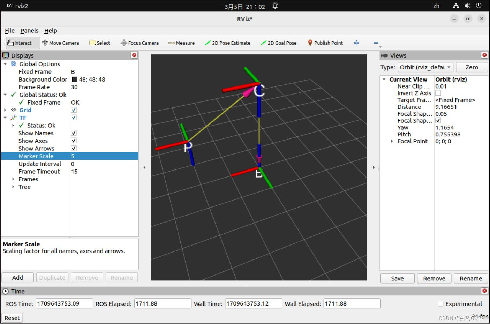
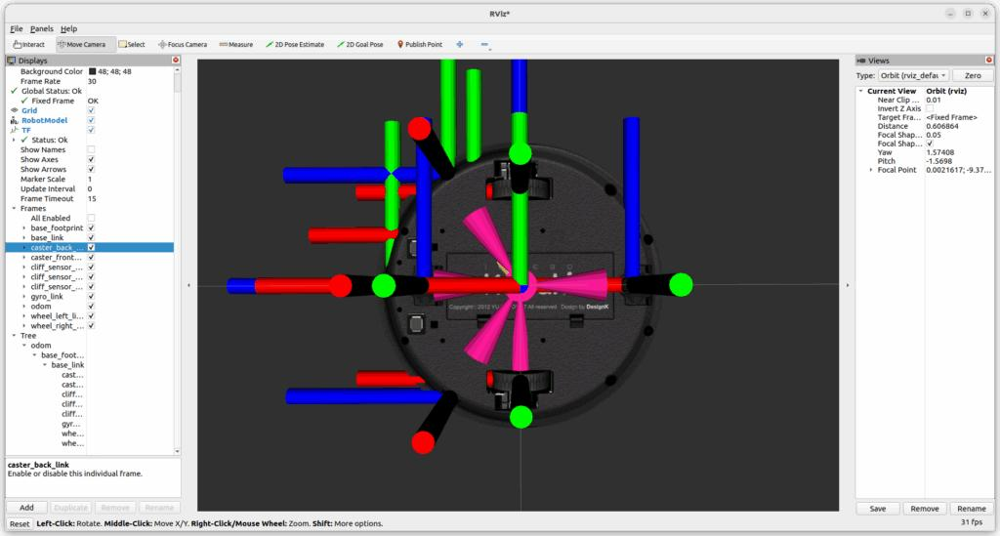
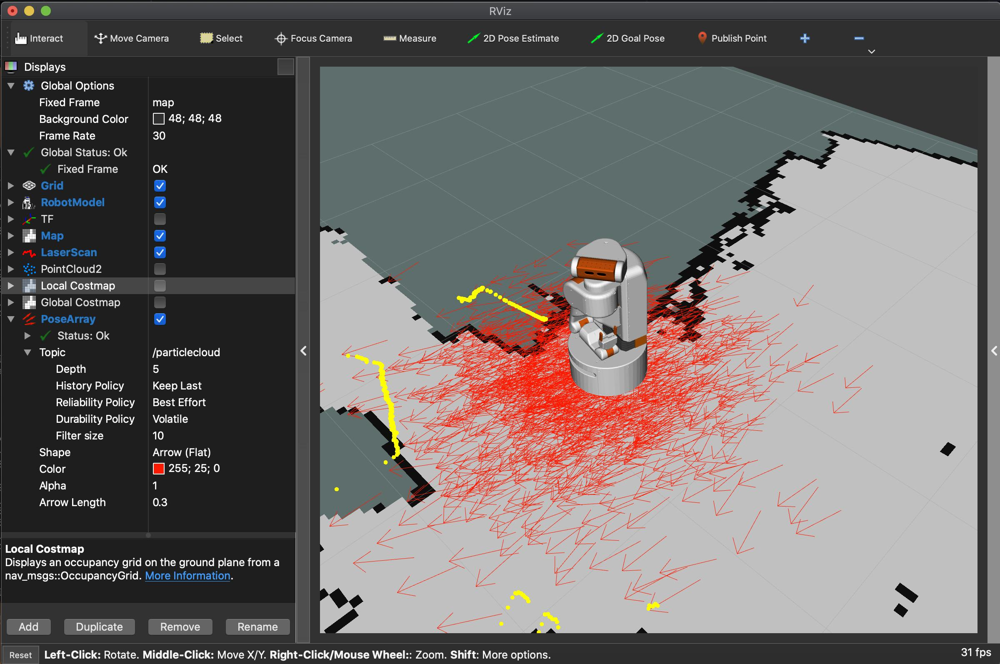
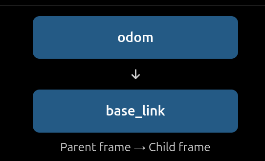
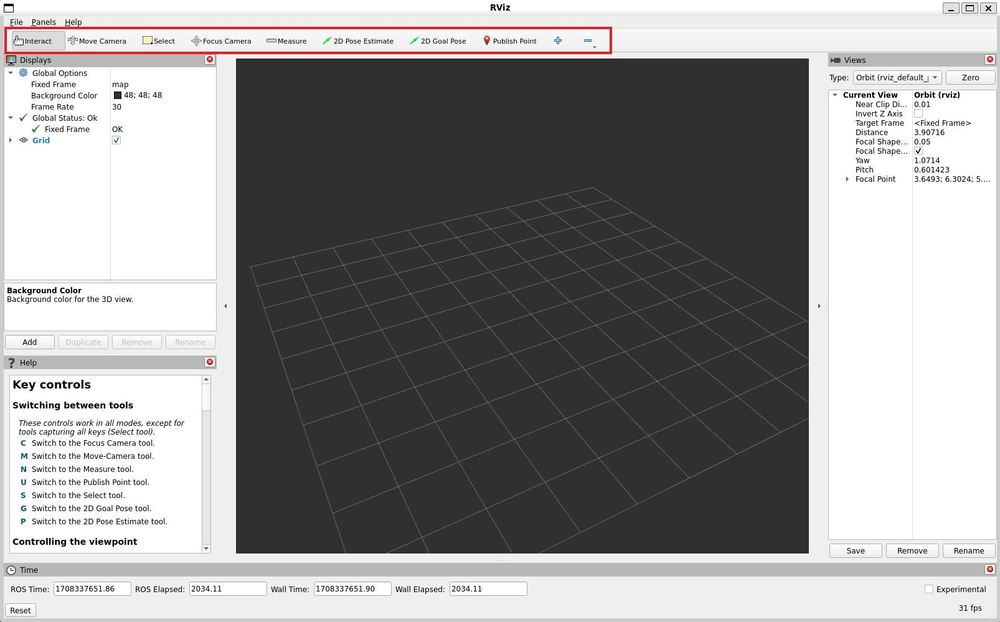

# Visualizing TF2 in RViz2

RViz2 is a 3D visualization tool for ROS 2. It allows us to see the robot model, coordinate frames, sensors, laser scans, and other ROS data.

[从头手搓一台ros2复合机器人（带机械臂）_ros 机械臂-CSDN博客](https://images.openai.com/static-rsc-4/6oCjbDre6BGpVszhfx8zU0VYtU20SKANwxEtzr-SOLpAu4GIsAwdu8pAk6lU0oL-ymZOkS8XXOzVL_v6a6K9Eoo9JMLDzBJ9Wc1JrsCwDOlGrBusrQhF833iROpaYYMY_NLb445VqzBasy84HtQd8OEUII7zm4rkuRjdpiUdu_g?purpose=inline)


[TurtleBot2 kobukiがやってきた #4（ROS 2 Rviz2編）](https://images.openai.com/static-rsc-4/fkQIcXjT6TPLeHZgJfTSLgI35AVzsQ8xALyiqMkVrYJyL-tJ0g-f_ZMNRUDyXSjv2US5zuFjxmjlyIx-KLKvsA75R_mT-RT09B1SQngJC04JJDEtCA5gU75Q4X-6bl2Mmf6VWvl6hg9cOTCnqStqMrIAinp1fBogkctZ3zNnjAk?purpose=inline)


[Mapping and Localization in ROS 2 · Robot & Chisel](https://images.openai.com/static-rsc-4/S7hIpQsXwdgHoJF6FGXcEa95SVXIGH_5pW2UJCXOZUr6YHLDCxhSccu0QH-M2DoCF6643Oh56p5lT0xjlWLbjJ4zJ6QGFvMeyLkpjJvJZsSzn1onZv3bn5LmXUMi0Cvh6-GHhZVXGL_3-QUogoPcamMmQ5OBmFIC3VP9dPg-YHg?purpose=inline)


## 1. What will we learn?

In this lesson, we'll:

1. Generate a TF tree diagram.
    
2. Visualize coordinate frames in RViz2.
    
3. Understand the Fixed Frame setting.
    
4. Inspect the relationship between `odom` and `base_link`.
    

## 2. First, run your dynamic TF broadcaster

On your Ubuntu laptop, open Terminal 1:

```bash
ros2 run robot_basics dynamic_tf_broadcaster
```

Keep it running.

Your node continuously publishes:

```text
odom → base_link
```

Important: Stop the old static broadcaster if it is still running. For this exercise, we are using the dynamic broadcaster only.

## 3. Generate the TF tree

Open Terminal 2:

```bash
ros2 run tf2_tools view_frames
```

This command listens to TF information and generates a PDF showing the coordinate frame relationships.

You should see something similar to:

```text
Listening to tf data...
Generating graph...
```

Check the generated file:

```bash
ls frames*
```

Usually, it generates:

```text
frames.pdf
```

Open it:

```bash
xdg-open frames.pdf
```

You should see a tree similar to:



This is called a TF tree.

## 4. Open RViz2

Open Terminal 3:

```text
rviz2
```

RViz2 should open with a 3D visualization window.

[RViz2 User Guide — ROS 2 documentation documentation](https://images.openai.com/static-rsc-4/YpHdwdmz0Hysgt-FAZxsLxieFwRh5pfRIf6JJziEZC9K7ZzmjqtX77XKNS8xd6ZVOCbWyrjiS0RgUY6R1REQQI3aaTUPSgZdmh5os98GWRPzUNPf2C3LM7z5jgqgB28Ye_x9dMMCSNTGzqfd-_h63GztmxSjZ5qTRtvq3cfmr0M?purpose=inline)

[docs.ros.org](https://docs.ros.org/en/humble/Tutorials/Intermediate/RViz/RViz-User-Guide/RViz-User-Guide.html)

If the command is not found, install it:

```bash
sudo apt update
sudo apt install ros-humble-rviz2
```

## 5. Configure the Fixed Frame

In RViz2, look at the left-side Displays panel.

Find:

```text
Global Options
    Fixed Frame: map
```

Change `map` to:

```text
odom
```

Why?

Our dynamic broadcaster publishes the transform:

```text
odom → base_link
```

Therefore, `odom` is the appropriate fixed reference frame for this exercise.

## 6. Add TF visualization

In RViz2:

1. Click Add at the bottom-left.
    
2. Select the By display type tab.
    
3. Choose TF.
    
4. Click OK.
    

![[Pasted image 20261110104331.png]]
You should now see the coordinate axes for the `odom` and `base_link` frames.


[note.com](https://note.com/npaka/n/n453bbb36cb10)

You can expand the TF display in the left panel to see the available frames.

## 7. Understand what you are seeing

Our dynamic broadcaster updates:

```text
self.x += 0.05self.angle += 0.02
```

Every 0.1 seconds.

This means:

- The robot moves forward.
    
- The robot gradually rotates.
    
- RViz2 receives updated transformations.
    
- The `base_link` axes move relative to `odom`.
    

Note: This is only a simulated coordinate-frame movement. We haven't created a robot model or connected physical motors yet.

## 8. Useful TF2 commands

| Command                                    | Purpose                      |
| ------------------------------------------ | ---------------------------- |
| `ros2 topic list`                          | Lists ROS topics             |
| `ros2 topic echo /tf`                      | Displays dynamic TF messages |
| `ros2 topic echo /tf_static`               | Displays static TF messages  |
| `ros2 run tf2_ros tf2_echo odom base_link` | Displays transformation      |
| `ros2 run tf2_tools view_frames`           | Generates TF tree PDF        |

---

[Next: URDF: Create your first robot model](./urdf.md)
