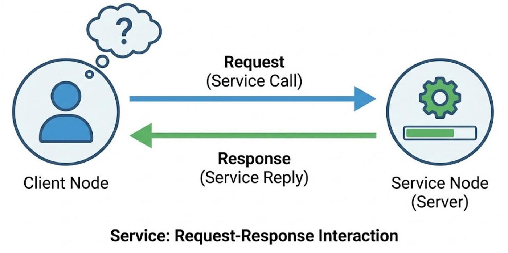

# Services

So far, you've learned about Topics, where nodes continuously exchange messages.

Now we'll learn about Services, where one node sends a request and another node sends back a response.

## 1. What is a ROS 2 service?

Imagine your robot has a motor.

You want to turn the motor ON or OFF. Instead of continuously publishing messages, you can send a request to the robot.

[ROS 2: Robot Operating System. 1. What is ROS 2? | by Dilip Kumar | Jan, 2026 | Medium](https://images.openai.com/static-rsc-4/-_Mq6N_s9duChLf6ZD3rOEr5g4yY_xs73zFF2WqJBBAU48Hooax2Z_DSU0oJgX7z2icR4ejjADwq3VTEowt6uPwrIaOpTuQrhVz99ER8aznycSGQzV-Tf03KVZQG-SW1LNkXq2ZjRsTSZqbZVBsfWIsjIWE5TfCE8KWuCxEfqlg?purpose=inline)

[dilipkumar.medium.com](https://dilipkumar.medium.com/ros2-robot-operating-system-5978dcfd73f3)

The communication works like this:

1. The client sends a request.
    
2. The server receives the request.
    
3. The server performs an operation.
    
4. The server sends a response to the client.
    

For example:

|Client request|Server response|
|---|---|
|Turn motor ON|Motor turned ON|
|Turn motor OFF|Motor turned OFF|

Difference between Topics and Services

|Topics|Services|
|---|---|
|Continuous communication|Request-response communication|
|Publisher and subscriber|Client and server|
|Asynchronous data stream|Request followed by response|
|Example: sensor readings|Example: turn motor ON/OFF|

## 2. Create our first service package

We'll create a simple motor-control service.

We'll work on your Ubuntu laptop.

Open a terminal:

```bash
cd ~/ros2_ws/src

ros2 pkg create robot_services \
--build-type ament_python \
--dependencies rclpy std_srvs
```

Here:

- `robot_services` is our package name.
    
- `rclpy` provides Python ROS 2 functionality.
    
- `std_srvs` provides standard service definitions.
    

## 3. Create the service server

Create a Python file:

```bash
cd ~/ros2_ws/src/robot_services/robot_services

nano motor_server.py
```

Paste this code:

```python
import rclpy
from rclpy.node import Node
from std_srvs.srv import SetBool


class MotorServer(Node):

    def __init__(self):
        super().__init__('motor_server')

        self.motor_on = False

        self.service = self.create_service(
            SetBool,
            'motor_control',
            self.control_motor
        )

        self.get_logger().info('Motor service is ready!')

    def control_motor(self, request, response):

        self.motor_on = request.data

        if self.motor_on:
            response.success = True
            response.message = "Motor turned ON"
        else:
            response.success = True
            response.message = "Motor turned OFF"

        self.get_logger().info(response.message)

        return response


def main(args=None):

    rclpy.init(args=args)

    node = MotorServer()

    rclpy.spin(node)

    node.destroy_node()

    rclpy.shutdown()


if __name__ == '__main__':
    main()
```

### Understand the important parts

1. Import SetBool

```python
from std_srvs.srv import SetBool
```

`SetBool` is a predefined ROS 2 service type.

It accepts a Boolean request (`True` or `False`) and returns:

- `success`: whether the operation succeeded.
    
- `message`: a response message.
    

2. Create the service

```python
self.service = self.create_service(    SetBool,    'motor_control',    self.control_motor)
```

This creates a service named `/motor_control`.

3. Process the request

```python
self.motor_on = request.data
```

If the client sends `True`, the motor is switched ON in our simulation.

If it sends `False`, the motor is switched OFF.

4. Return the response

```python
return response
```

This sends the result back to the client.

## 4. Register the executable

Open `setup.py`:

```bash
cd ~/ros2_ws/src/robot_services
nano setup.py
```

Find `entry_points` and update it:

```python
entry_points={    'console_scripts': [        'motor_server = robot_services.motor_server:main',    ],},
```

Save the file.

## 5. Build the package

```bash
cd ~/ros2_ws

colcon build --packages-select robot_services

source install/setup.bash
```

## 6. Run the service server

Start the server:

```bash
ros2 run robot_services motor_server
```

Expected output:

```text
[INFO] [motor_server]: Motor service is ready!
```

Keep this terminal running.

## 7. Send requests using the ROS 2 command line

Open another terminal on your laptop.

Source the workspace:

```bash
source ~/ros2_ws/install/setup.bash
```

Check available services:

```bash
ros2 service list
```

You should find:

```text
/motor_control
```

Turn the motor ON:

```bash
ros2 service call /motor_control std_srvs/srv/SetBool "{data: true}"
```

Expected response:

```text
success: true
message: Motor turned ON
```

Turn the motor OFF:

```bash
ros2 service call /motor_control std_srvs/srv/SetBool "{data: false}"
```

Expected response:

```text
success: true
message: Motor turned OFF
```


# Service Client in Python

Previously, we created a service server and called it using the terminal. Now we'll create a Python client that sends requests to the server.

Our communication will look like this:

[ROS 2: Robot Operating System. 1. What is ROS 2? | by Dilip Kumar | Jan, 2026 | Medium](https://images.openai.com/static-rsc-4/-_Mq6N_s9duChLf6ZD3rOEr5g4yY_xs73zFF2WqJBBAU48Hooax2Z_DSU0oJgX7z2icR4ejjADwq3VTEowt6uPwrIaOpTuQrhVz99ER8aznycSGQzV-Tf03KVZQG-SW1LNkXq2ZjRsTSZqbZVBsfWIsjIWE5TfCE8KWuCxEfqlg?purpose=inline)

[dilipkumar.medium.com](https://dilipkumar.medium.com/ros2-robot-operating-system-5978dcfd73f3)

- `motor_server.py` – receives requests and controls the simulated motor.
    
- `motor_client.py` – sends ON/OFF requests.
    
- `/motor_control` – service name.
    
- `SetBool` – service type.
    

## 1. Create the client file

On your Ubuntu laptop:

```bash
cd ~/ros2_ws/src/robot_services/robot_services
nano motor_client.py
```

Paste this code:

```python
import rclpy
from rclpy.node import Node
from std_srvs.srv import SetBool


class MotorClient(Node):

    def __init__(self):
        super().__init__('motor_client')

        self.client = self.create_client(
            SetBool,
            'motor_control'
        )

        self.get_logger().info('Waiting for motor service...')

        self.client.wait_for_service()

        self.get_logger().info('Motor service connected!')

    def send_request(self, state):

        request = SetBool.Request()
        request.data = state

        future = self.client.call_async(request)

        rclpy.spin_until_future_complete(self, future)

        response = future.result()

        self.get_logger().info(
            'Success: %s, Message: %s'
            % (response.success, response.message)
        )


def main(args=None):

    rclpy.init(args=args)

    node = MotorClient()

    node.send_request(True)

    node.send_request(False)

    node.destroy_node()

    rclpy.shutdown()


if __name__ == '__main__':
    main()
```

## 2. Understand the important code

Create the client

```python
self.client = self.create_client(    SetBool,    'motor_control')
```

Creates a client that communicates with the `/motor_control` service.

Wait for the server

```python
self.client.wait_for_service()
```

The client waits until the service server becomes available.

Prepare the request

```python
request = SetBool.Request()request.data = state
```

Creates a request and assigns either `True` or `False`.

Send the request

```python
future = self.client.call_async(request)
```

Sends the request asynchronously. A future represents the result that will become available when the server responds.

Wait for the response

```python
rclpy.spin_until_future_complete(self, future)
```

Waits until the response is received.

## 3. Register the client executable

Open:

```bash
cd ~/ros2_ws/src/robot_services
nano setup.py
```

Update your `entry_points`:

```python
entry_points={    
      'console_scripts': [
              'motor_server = robot_service.motor_server:main',        
              'motor_client = robot_services.motor_client:main',    
              ],
            },
```

## 4. Build the package

```bash
cd ~/ros2_ws

colcon build --packages-select robot_services

source install/setup.bash
```

## 5. Run the application

Open Terminal 1:

```bash
source ~/ros2_ws/install/setup.bash
ros2 run robot_services motor_server
```

Open Terminal 2:

```bash
source ~/ros2_ws/install/setup.bash
ros2 run robot_services motor_client
```

Expected client output:

```bash
Waiting for motor service...
Motor service connected!
Success: True, Message: Motor turned ON
Success: True, Message: Motor turned OFF
```

The server should also print:

```bash
Motor service is ready!
Motor turned ON
Motor turned OFF
```

## What have we learned?

| Concept        | Purpose                              |
| -------------- | ------------------------------------ |
| Service server | Receives requests                    |
| Service client | Sends requests                       |
| Request        | Contains input data                  |
| Response       | Contains result                      |
| Future         | Represents a pending response        |
| `call_async()` | Sends a non-blocking service request |

---

[Next: Actions](./actions.md)
