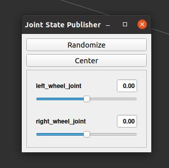
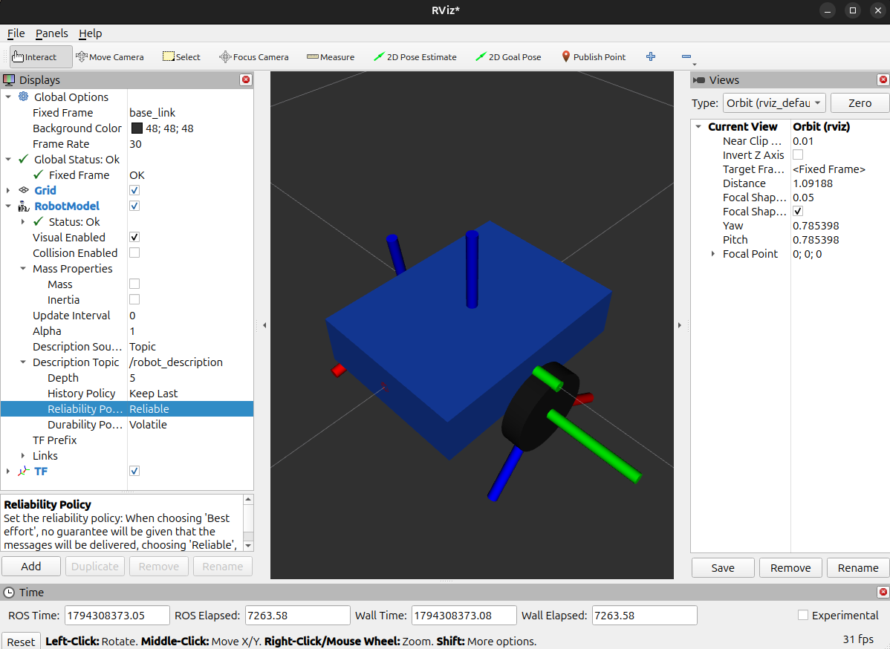

#  URDF – Creating Your First Robot Model

Now we are moving from individual coordinate frames to building an actual robot model.

URDF (Unified Robot Description Format) is an XML format used in ROS 2 to describe a robot's physical structure.

With URDF, we can define:

- Robot body and wheels.
    
- Sensors such as LiDAR and cameras.
    
- Links and joints connecting different parts.
    
- Visual appearance and collision shapes.
    
- Physical properties such as mass and inertia.
    

Our goal is to build a simple two-wheeled differential-drive robot, which we will later simulate in Gazebo.

## 1. Understand links and joints

URDF has two fundamental concepts.

Link: A physical part of the robot.

Examples:

- `base_link` – robot body.
    
- `left_wheel_link` – left wheel.
    
- `right_wheel_link` – right wheel.
    

Joint: A connection between two links.

Examples:

- Fixed joint – parts cannot move relative to each other.
    
- Continuous joint – allows unlimited rotation, such as a wheel.
    
- Revolute joint – allows rotation within specified limits.

Our robot will have this structure:

```bash
             base_link
              /     \
             /       \
    left_wheel       right_wheel
```

## 2. Create a robot description package

Use your Ubuntu laptop.

Open a terminal:

```bash
cd ~/ros2_ws/src

ros2 pkg create robot_description \
    --build-type ament_cmake \
    --dependencies robot_state_publisher joint_state_publisher_gui
```

This creates a new package for storing your robot model.

Create the required folders:

```bash
cd ~/ros2_ws/src/robot_description

mkdir urdf launch
```

Your folder structure will look like:

```text
robot_description/
├── CMakeLists.txt
├── package.xml
├── urdf/
└── launch/
```

## 3. Create your first URDF file

Create:

```bash
nano urdf/my_robot.urdf
```

Paste this code:

```xml

<?xml version="1.0"?>

<robot name="my_robot">

    <!-- Main robot body -->
    <link name="base_link">

        <visual>
            <geometry>
                <box size="0.4 0.3 0.1"/>
            </geometry>

            <origin xyz="0 0 0" rpy="0 0 0"/>

            <material name="blue">
                <color rgba="0.1 0.3 0.8 1"/>
            </material>
        </visual>

    </link>


    <!-- Left wheel -->
    <link name="left_wheel_link">

        <visual>
            <geometry>
                <cylinder radius="0.08" length="0.04"/>
            </geometry>

            <origin xyz="0 0 0" rpy="1.5708 0 0"/>

            <material name="black">
                <color rgba="0.1 0.1 0.1 1"/>
            </material>
        </visual>

    </link>


    <!-- Right wheel -->
    <link name="right_wheel_link">

        <visual>
            <geometry>
                <cylinder radius="0.08" length="0.04"/>
            </geometry>

            <origin xyz="0 0 0" rpy="1.5708 0 0"/>

            <material name="black">
                <color rgba="0.1 0.1 0.1 1"/>
            </material>
        </visual>

    </link>


    <!-- Left wheel joint -->
    <joint name="left_wheel_joint" type="continuous">

        <parent link="base_link"/>
        <child link="left_wheel_link"/>

        <origin xyz="0 0.17 -0.08" rpy="0 0 0"/>

        <axis xyz="0 1 0"/>

    </joint>


    <!-- Right wheel joint -->
    <joint name="right_wheel_joint" type="continuous">

        <parent link="base_link"/>
        <child link="right_wheel_link"/>

        <origin xyz="0 -0.17 -0.08" rpy="0 0 0"/>

        <axis xyz="0 1 0"/>

    </joint>

</robot>
```

Save the file using `Ctrl + O`, Enter, and `Ctrl + X`.

### 4. Understand the important URDF elements

A. Link

```xml
<link name="base_link">
```

Defines a physical component of the robot.

B. Geometry

```xml
<box size="0.4 0.3 0.1"/>
```

Defines the robot body dimensions:

|Dimension|Measurement|
|---|---|
|Length (X)|0.4 m|
|Width (Y)|0.3 m|
|Height (Z)|0.1 m|

The wheels use:

```xml
<cylinder radius="0.08" length="0.04"/>
```

C. Joint

```xml
<joint name="left_wheel_joint" type="continuous">
```

Connects the wheel to the robot body and allows continuous rotation.

D. Parent and child

```xml
<parent link="base_link"/>
<child link="left_wheel_link"/>
```

This means the left wheel is connected to the robot body.

E. Origin

```xml
<origin xyz="0 0.17 -0.08" rpy="0 0 0"/>
```

Defines the wheel's position and orientation relative to the parent link.

- `xyz`: Position.
    
- `rpy`: Roll, pitch and yaw.
    

F. Axis

```xml
<axis xyz="0 1 0"/>
```

Defines the axis around which the wheel rotates.

## 5. Configure the package to install URDF and launch files

Open:

```bash
nano CMakeLists.txt
```

Find the existing line:

```text
ament_package()
```

Add this immediately before it:

```cmake
install(
  DIRECTORY urdf launch
  DESTINATION share/${PROJECT_NAME}
)
```
Important: We have removed:

```cmake
find_package(robot_state_publisher REQUIRED)
find_package(joint_state_publisher_gui REQUIRED)
```
Now open:

```bash
nano package.xml
```

Add these dependencies before the closing `</package>`:

```xml
<exec_depend>robot_state_publisher</exec_depend>
<exec_depend>joint_state_publisher_gui</exec_depend>
<exec_depend>launch</exec_depend>
<exec_depend>launch_ros</exec_depend>
```

## 6. Create a launch file

Instead of manually starting multiple ROS 2 nodes, we can start them together using a launch file.

Create:

```bash
nano launch/display_robot.launch.py
```

Add:

```python

import os

from launch import LaunchDescription
from launch_ros.actions import Node
from ament_index_python.packages import get_package_share_directory


def generate_launch_description():

    package_path = get_package_share_directory(
        'robot_description'
    )

    urdf_file = os.path.join(
        package_path,
        'urdf',
        'my_robot.urdf'
    )

    with open(urdf_file, 'r') as file:
        robot_description = file.read()

    return LaunchDescription([

        Node(
            package='robot_state_publisher',
            executable='robot_state_publisher',
            parameters=[{
                'robot_description': robot_description
            }]
        ),

        Node(
            package='joint_state_publisher_gui',
            executable='joint_state_publisher_gui'
        )

    ])

```

The launch file starts two important nodes:

|Node|Purpose|
|---|---|
|`robot_state_publisher`|Publishes robot link transformations|
|`joint_state_publisher_gui`|Provides sliders to control movable joints|

## 7. Build the package

```bash
cd ~/ros2_ws

colcon build --packages-select robot_description

source install/setup.bash
```

If you encounter missing package errors, install:

```bash
sudo apt install ros-humble-robot-state-publisher \
ros-humble-joint-state-publisher-gui \
ros-humble-rviz2
```

## 8. Launch your robot

Run:

```bash
ros2 launch robot_description display_robot.launch.py
```

You should see a joint control window.

purpose=inline)

[cloud.tencent.com](https://cloud.tencent.com/developer/article/2520299)

Open another terminal and run:

```text
rviz2
```

In RViz2:

1. Set Fixed Frame to `base_link`.
    
2. Click Add.
    
3. Select RobotModel.
    
4. Click OK.

Now expand the RobotModel display.

Check whether its Status says `OK` or shows an error.

Also check:

- Global Options → Fixed Frame = `base_link`
    
- RobotModel → Description Topic = `/robot_description` (if your RViz2 version shows this setting).

You should see your blue robot body and two black wheels.


You can move the wheel sliders in the joint control window and observe the robot model.

## 9. Important ROS 2 commands

```bash
ros2 node list
```

Lists the running ROS 2 nodes.

```bash
ros2 topic list
```

Lists available topics.

```bash
ros2 topic echo /joint_states
```

Displays wheel joint positions and velocities.

```bash
ros2 run tf2_tools view_frames
```

Generates the robot's TF tree.

---

[Next: Xacro: Simplify URDF](./xacro.md)
